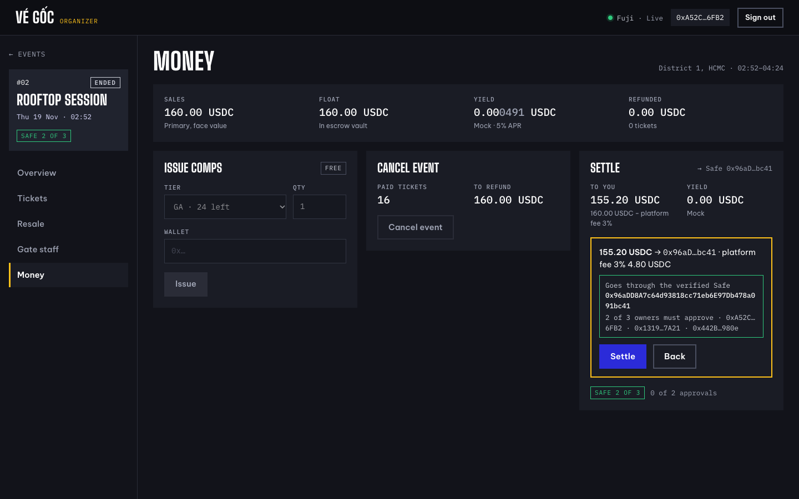

# Vé Gốc: concert tickets that cannot be scalped above face value +10 %

Slides: _link to be added before submission_ · Video (2 to 3 min): _link to be added before submission_

Diamond VIP tickets for BIGBANG's Hanoi shows (24 and 25 Oct 2026, [CafeF](https://cafef.vn/chinh-thuc-cong-bo-seat-map-va-gia-ve-concert-bigbang-o-ha-noi-dat-xat-ra-mieng-cao-nhat-105-trieu-dong-188260803093946955.chn)) had a face value of 9.8 million VND and were advertised by resellers for 45 million, about 4.6 times ([DTiNews, 13 Aug 2026](https://dtinews.dantri.com.vn/print/20260813142023123.htm)). Vé Gốc ("face-value ticket") makes the ticket an NFT that only changes hands through a built-in market, at face value +10 % at most. Ticket money waits in an escrow vault. A cancelled show, or a show that never opens its gate, pays every buyer back from that vault. Entry is a QR signed by whoever holds the ticket right now, so a QR made before a resale stops working.

Live on Avalanche Fuji. Built from 2 to 19 Nov 2026 for Team1 Vietnam UniHack 2026, topic 9 "Capped-resale NFT tickets with yielding float".




Every image above was captured on Fuji on 19 Nov 2026. The audience in the console (93 tickets, 15 resales, 40 check-ins) is sample activity created by [`scripts/fuji-seed.mjs`](scripts/fuji-seed.mjs) with real transactions from 40 script wallets.

## Live on Fuji (chain 43113)

| Contract | Address | Verified |
|---|---|---|
| VeGoc (events, tickets, market, gate, refunds) | [`0xc5f9302d37da0f2f749679dafd20100ca14b268d`](https://testnet.snowtrace.io/address/0xc5f9302d37da0f2f749679dafd20100ca14b268d) | yes (Routescan / Snowtrace) |
| FloatVault (escrow, mock yield from a funded reserve) | [`0x978835b9f206ee93dab9ca337646d6f5e45ace8e`](https://testnet.snowtrace.io/address/0x978835b9f206ee93dab9ca337646d6f5e45ace8e) | yes |
| MockUSDC (test token, 6 decimals, faucet) | [`0xfe9e8228ebe487e82c8386922417df3f16f39554`](https://testnet.snowtrace.io/address/0xfe9e8228ebe487e82c8386922417df3f16f39554) | yes |
| Safe v1.4.1, 2 of 3 owners (organizer of events 0, 2, 5; receives the 3 % platform fee) | [`0x96aDD8A7c64d93818cc71eb6E97Db478a091bc41`](https://testnet.snowtrace.io/address/0x96aDD8A7c64d93818cc71eb6E97Db478a091bc41) | canonical Safe proxy ([created here](https://testnet.snowtrace.io/tx/0x68040446ded82594b72d3f65f80db922c88e0bfbded87c7c517da193359fe3e5)) |

The same code is deployed a second time against Circle's own test USDC, [`0x5425890298aed601595a70AB815c96711a31Bc65`](https://testnet.snowtrace.io/address/0x5425890298aed601595a70AB815c96711a31Bc65): VeGoc [`0x7c4a9af8d840b366ffc12dfab8f21afb0b866c8c`](https://testnet.snowtrace.io/address/0x7c4a9af8d840b366ffc12dfab8f21afb0b866c8c), FloatVault [`0xff68cd8d390b6115463338864d94b576f85cb29a`](https://testnet.snowtrace.io/address/0xff68cd8d390b6115463338864d94b576f85cb29a), both verified. One event ran there from sale to settlement (see below).

Deployed at block 61292997 by `0xA52C09A9F0E0Dc256a2454934782468880226FB2` ([VeGoc deploy tx](https://testnet.snowtrace.io/tx/0x2c349cb02f8b15995199754b19b05ebb8d114d3e9d182b4024b893c5260d1e34)). Addresses and every transaction hash quoted in this file are in [`docs/fuji-deployment.json`](docs/fuji-deployment.json), [`docs/fuji-run.json`](docs/fuji-run.json), [`docs/fuji-run-usdc.json`](docs/fuji-run-usdc.json) and [`docs/fuji-measure.json`](docs/fuji-measure.json).

Events on chain:

| # | Event | Organizer | State on 19 Nov 2026 |
|---|---|---|---|
| 0 | Neon Pulse Festival, GA 25 / VIP 60 USDC, max 4 per wallet, ends 13 Dec | Safe ([created through the Safe](https://testnet.snowtrace.io/tx/0xcf7accacb873f865ee08e0f0743105a59d581a4a3e23cd8c8e4767c351f55b5f)) | on sale: 93 sold by the seed script, 15 resales, 40 checked in, a few listed |
| 1 | Saigon Indie Night, 5 Dec | organizer wallet | on sale, 12 sold |
| 2 | Rooftop Session | Safe | ended with the gate quorum met (9 of 16 scanned), not settled yet |
| 3 | Hanoi Lantern Night | organizer wallet | cancelled, all 5 tickets refunded |
| 4 | Soundcheck Session | organizer wallet | ended with nobody scanned: no-show, refunds open, settlement locked until 21 Nov 00:25 (+07) |
| 5 | Warm-up Set | Safe | ended, settled by two Safe owners |
| 6, 7, 8 | second copies of events 1, 2 and 4 (`node scripts/fuji-seed.mjs --restage`) | wallet, Safe, wallet | spares for the demo recording: one to cancel, one to settle through the Safe, one no-show |

Checks anyone can run (`B=0xc5f9302d37da0f2f749679dafd20100ca14b268d`, `R=https://avalanche-fuji-c-chain-rpc.publicnode.com`, `H=0xc087c8a04C88c08C9b7F0091cfd4b7108A1f9f91` holds ticket 60):

| Rule | Command | Answer |
|---|---|---|
| No transfer outside the market | `cast call $B 'transferFrom(address,address,uint256)' $H 0x9638F49A3cB7c002779724b427905F6Ab1D54BFA 60 --from $H --rpc-url $R` | reverts `0xf90e674a` = `TransferBlocked()` |
| Resale cap | `cast call $B 'list(uint256,uint256)' 60 27500001 --from $H --rpc-url $R` | reverts `AboveCap(27500000)` |
| QR valid 5 minutes at most | `cast call $B 'checkIn(uint256,uint256,bytes)' 60 1900000000 0x00 --from 0x058b326D8A3B7f69FAC9cFB0a772a63e4d26FAA1 --rpc-url $R` | reverts `0x48f0fae6` = `DeadlineTooFar()` |
| No-show: organizer locked out | `cast call $B 'settle(uint256,address)' 4 0xA52C09A9F0E0Dc256a2454934782468880226FB2 --from 0xA52C09A9F0E0Dc256a2454934782468880226FB2 --rpc-url $R` | reverts `DisputeWindow(1795195525)` until 20 Nov 17:25 UTC |
| Escrow is whole | `cast call 0x978835b9f206ee93dab9ca337646d6f5e45ace8e 'totalPrincipal()(uint256)' --rpc-url $R` plus `reserve()` | equals the vault's USDC balance |

## Measured on Fuji

Three rounds on 19 Nov 2026 with [`scripts/measure.mjs`](scripts/measure.mjs); medians, raw rows in [`docs/fuji-measure.json`](docs/fuji-measure.json). Each transaction is signed first and the clock starts when it is sent. "In a block" is the block's own millisecond timestamp (Avalanche blocks carry `timestampMilliseconds`) minus the send time. "Receipt" is when the script held the receipt from a public RPC polled every 100 ms.

| Action | Tx | Gas | In a block after | Receipt after | Fee on Fuji | Fee at the C-Chain mainnet base fee* |
|---|---|---|---|---|---|---|
| Buy 1 GA ticket: permit and purchase in one transaction | [0xf853…83bd](https://testnet.snowtrace.io/tx/0xf85350a6566ee3b445e8ef04fd92c61d7636676ee3fff93d2a718609d88b83bd) | 216,470 | 0.4 s | 2.4 s | 0.035 nAVAX | 0.0016 AVAX |
| List for resale at the cap | [0x912c…67c5](https://testnet.snowtrace.io/tx/0x912c52a448ccd3b53a1e18ee2f3987879bd3e1a9206b0d2a1ea11ea7b83e67c5) | 65,896 | 0.3 s | 2.4 s | 0.011 nAVAX | 0.0005 AVAX |
| Buy the resale listing (permit and purchase) | [0x2eff…9ed2](https://testnet.snowtrace.io/tx/0x2eff099c6ece62a6e01c849a3f6fb229ba181202363699513583714355459ed2) | 160,446 | 0.4 s | 2.5 s | 0.026 nAVAX | 0.0012 AVAX |
| Gate check-in | [0x86d2…fd21](https://testnet.snowtrace.io/tx/0x86d28e9e4f3cc19becfc12ea42a7f5b2a70aa3b758bda62942b89ea80535fd21) | 55,554 | 0.6 s | 2.4 s | 0.0089 nAVAX | 0.0004 AVAX |

\* gas × 7.502 nAVAX, the base fee `cast base-fee --rpc-url https://api.avax.network/ext/bc/C/rpc` returned when the script ran. The Fuji transactions paid 160 wei per gas (10 wei base fee plus a 150 wei tip), so the Fuji column is not a realistic cost. 1 nAVAX is 0.000000001 AVAX.

The chain put each transaction in a block about half a second after it was sent. The remaining two seconds are the public RPC serving the receipt. The app prints both numbers and the fee on every confirmation, for example `BLOCK +0.5 S · RECEIPT +2.9 S · FEE 0.032 nAVAX`.

## What ran on Fuji

| Flow | Transactions | Result |
|---|---|---|
| Sale, capped resale, entry (event 0) | [buy](https://testnet.snowtrace.io/tx/0xd4625ca55f4898d02f7c5a47777cddfaf8414651cb89dc8dd1a54161b708ff35), [list](https://testnet.snowtrace.io/tx/0xbccbeeb56ba12626e5a82938c1f5a1ae07630408e319d71e6e646103958a9167), [resale](https://testnet.snowtrace.io/tx/0x90d23967b57595ab3de98f3e7327ea02d265b637857071ea9f06a460965f1217), [check-in](https://testnet.snowtrace.io/tx/0x6bebfd628073290fbc5634b222f1b5b7849d2ccbcea16787ef2beda0fbb78067) | 2,745 USDC in escrow after 93 sales; the 15 resales averaged about 108 % of face |
| Cancel and refund (event 3) | [cancel](https://testnet.snowtrace.io/tx/0x5239966a16aae1e1661e6fef0fbedc6f3b1d13aa04a1f63650f37d83417f08c1), [`refundMany` of 5 tickets](https://testnet.snowtrace.io/tx/0x97870e8c45d6137e8eb4b4ab50c2ebf26b01aec33767677238449c3e0106728e) | 100 USDC back to four wallets in one transaction, 247,648 gas; the yield stopped at the cancel |
| No-show (event 4): 4 sold, 0 scanned | [holder claims](https://testnet.snowtrace.io/tx/0x7173f2368870adcbeea6b469e2c89b7b1a7820bbbd14d0f66e23f93233bc8caa), [a bystander pushes a refund to another holder](https://testnet.snowtrace.io/tx/0xfd5fadfb4ff544c0bfe4223359a1d2bc57c9bb22341ae1c891c74de998dc5856) | 20 USDC refunded; `settle` reverts `DisputeWindow`; two tickets are left refundable for the demo |
| Settlement by the Safe (event 5): 6 sold, 4 scanned | [owner 1 approves](https://testnet.snowtrace.io/tx/0xbca67a8b0d29cfbfa0f70db4099c1fd7fd2357bd78770e52464814e2ca4180dc), [owner 2 executes](https://testnet.snowtrace.io/tx/0x6fe9fcddb2aa23cffbb381d351cad73b6482b2586261f8b90d345f0d3466b1eb) | 58.20 USDC proceeds, 1.80 USDC platform fee (3 %) and 0.000072 USDC mock yield arrive in the Safe |
| Organizer action from the console through the Safe (event 0: grant a gate wallet, then revoke it) | grant: [owner 1 approves](https://testnet.snowtrace.io/tx/0xb5655deb2ff3edaeaef7d82ed72968e28771295976a9cd4bdbc9f86d4c3bdc2b), [owner 2 executes](https://testnet.snowtrace.io/tx/0x3e7776e2d3035eb4a167d4937ef44e73ca13679acca7f43faceffb24af4c6130); revoke: [owner 2 approves](https://testnet.snowtrace.io/tx/0xf212ba779a071f7606eb9cd3c743ea3ab071e2dc3db8292b734fd5fe1e1e2a83), [owner 1 executes](https://testnet.snowtrace.io/tx/0x9bc73c8b07c00d62626f3449effbaefbb949aee6309830453ce108322c79e010) | the console's own Safe path, clicked through in two browser profiles: "Approved 1 of 2", then "executed by the Safe" |
| Circle USDC deployment, one event end to end | [swap test AVAX for USDC on Pangolin](https://testnet.snowtrace.io/tx/0x169c6e4d3f230adcafc8ce02302bf20daf57be2353c49079064bd466b7b5e68b), [buy with Circle's permit](https://testnet.snowtrace.io/tx/0xc4d5d5d84a1ad3b9f58923581fb39a0bb4aa8919421254bdfe2caaf6f32b24bd), [resale with permit](https://testnet.snowtrace.io/tx/0x74617f75fd03f47dabe20d01a4c77925066c10a3baa60fb4286beb8adb4c7ab5), [check-in](https://testnet.snowtrace.io/tx/0x36479574746777e2a1594afa5fc19b65482fce0acaf10343ee46853210eb5f9f), [settle](https://testnet.snowtrace.io/tx/0xff50a6b614a80954cc4570adfc639f7ade21acaf99a8f3f6cd19efe5101a8fd0) | 0.194 USDC to the organizer and 0.006 USDC to the Safe, in Circle's token. Tickets cost 0.10 USDC there because the test USDC came from a small pool |

Circle's faucet needs a browser login, so the test USDC was bought with test AVAX on Pangolin's Fuji pool. Purchases on that deployment sign Circle's EIP-2612 permit, whose EIP-712 version is "2"; the app reads the version from the token.

## What it does

| | Guest (mobile app, `app/`) | Organizer (web console, `admin/`) |
|---|---|---|
| Event | browse events, tiers, seats left | create an event with up to 4 tiers and a per-wallet limit |
| Buy | pay USDC in one transaction through an EIP-2612 permit | issue free tickets (entry only, never resellable) |
| Resale | list at any price up to face +10 %, buy listings, unlist | listings, resale count, volume, average price against face |
| Gate | holder shows a signed QR valid 3 minutes; gate staff check in on chain | grant or revoke gate wallets; gate quorum counter |
| Money | refund button after a cancel or a no-show | float and mock yield live; cancel and refund every holder; settle after the show, minus the 3 % fee |
| Safe | | an event organized by a Safe needs two owners for each organizer action: the first approves, the second executes |

## How it works

- Tickets are ERC-721. `_update` lets a held ticket move only inside `buyListing`, so `transferFrom` between holders reverts. A checked-in ticket never moves again.
- `list` reverts above `face × 11000 / 10000`. `buyListing` takes a `maxPrice`, so a seller cannot raise the price under a pending purchase.
- A ticket can only be held by an address without code, and `checkIn` accepts an ECDSA signature from that address only (no ERC-1271). A contract that holds a ticket could be sold for any price without the ticket moving; here it cannot receive one, and one that buys from its own constructor ends up with a ticket nobody can check in.
- The entry QR carries the EIP-712 message `CheckIn(uint256 tokenId,uint256 deadline)` under the domain `{name: "VeGoc", version: "1", chainId, verifyingContract}`, signed by the holder. `checkIn` compares the signer with `ownerOf` at that moment, refuses a deadline more than 5 minutes ahead, and closes when the event ends.
- Primary-sale USDC goes to FloatVault under the event id. After the event the organizer can `settle`, and 3 % of the settled principal goes to the platform's `feeRecipient`. After `cancelEvent` the organizer can only take the yield accrued up to the cancel.
- Gate scans double as proof that the show happened. If fewer than 20 % of the paid tickets were scanned by the end, the event is a no-show: holders of unscanned tickets take face value back (`claimRefund`, or anyone calls `refundMany` for them) and `settle` stays locked for 48 hours. The organizer cannot produce scans for tickets other people hold, because each scan needs the holder's signature.
- Refunds are the face value the organizer received. A resale buyer who paid +10 % gets face value back, and the app says so next to the listings. Free tickets refund nothing and cannot be listed.
- There is no owner, pause or upgrade key in either contract.

Diagrams, state machines, role matrix and the threat model: [docs/ARCHITECTURE.md](docs/ARCHITECTURE.md).

## Who else does this, and what is different

| Product | What it does | Where the rule lives |
|---|---|---|
| Ticketmaster SafeTix | rotating barcode "tied directly to a verified fan account"; transfers only inside Ticketmaster ([Ticketmaster](https://business.ticketmaster.com/safetix/), [404 Media on the DOJ complaint, 21 Aug 2024](https://www.404media.co/ticketmaster-used-revolving-barcodes-to-control-ticket-resale-market-and-surveil-customers-doj-alleges/)) | the company's servers and app |
| Ticketbox resale (Vietnam) | official resale channel since Dec 2025; the buyer gets a new QR; no price cap or fee is published ([Ticketbox, 11 Dec 2025](https://www.threads.com/@ticketbox.vn/post/DSJrerOjsaZ/), [3 Mar 2026](https://www.threads.com/@ticketbox.vn/post/DVazeryj0jq/)) | the platform |
| CTicket REAL FAN (Vietnam) | artist quiz in place of a CAPTCHA and an IP filter at purchase, used for the BIGBANG sale ([VietNamNet, 21 Aug 2026](https://vietnamnet.vn/en/bigbang-hanoi-ticket-rush-puts-cticket-technology-to-the-test-2547749.html)) | the platform; it acts at purchase, resale happened anyway |
| OPEN, formerly GET Protocol | NFT tickets for ticketing companies, each sale, resale and scan recorded on Polygon ([docs, 10 Jun 2025](https://docs.onopen.xyz/docs/token-economics-overview)) | the docs do not say who enforces resale rules |
| Dreamus / SK Planet on an Avalanche subnet | NFT tickets in OK Cashbag; a maximum resale price can be set per collection ([Avalanche, 21 Sep 2023](https://www.avalanche.com/blog/korean-entertainment-giant-powers-ticketing-platform-with-avalanche), [Decrypt](https://decrypt.co/198091/south-koreas-dreamus-puts-nft-tickets-avalanche-events-kpop-concerts)) | the collection contract, on their own chain |
| UK law | resale above face value is to become illegal; not law yet on 24 Aug 2026 ([gov.uk, 19 Nov 2025](https://www.gov.uk/government/news/government-bans-ticket-touting-to-protect-fans-from-rip-off-prices), [Full Fact](https://fullfact.org/government-tracker/ticket-resales-consumer-protections/)) | legislation |

Capped NFT resale exists already. Three things here were not in the products above when we looked:

1. The gate QR is a signature by the wallet that owns the ticket at scan time, checked by a public contract. Any gate app can verify it, and the organizer cannot quietly change the rule.
2. Those same signatures decide who gets the money. Below a 20 % scan quorum the buyers can refund and the organizer waits; at or above it the organizer is paid at once. The no-show case needs no arbiter.
3. The platform fee is taken only from money that is paid out to an organizer. A cancelled or no-show event costs the buyer nothing and earns the platform nothing.

A cap in a contract does not stop a side payment: a scalper can list at the cap and take the premium by bank transfer. The listing is public, though, so anyone can buy it before the scalper's customer does, and the scalper cannot guarantee delivery.

## Business model

The platform takes 3 % of each settled event's primary sales (`feeBps = 300`, fixed at deployment, paid by `settle` to the Safe). Resale carries no fee today. The organizer keeps the float yield.

Worked example for a 10,000-seat show at an average of 2,000,000 VND per ticket (BIGBANG's Hanoi tiers ran from 1 to 10.5 million VND, [CafeF, 3 Aug 2026](https://cafef.vn/chinh-thuc-cong-bo-seat-map-va-gia-ve-concert-bigbang-o-ha-noi-dat-xat-ra-mieng-cao-nhat-105-trieu-dong-188260803093946955.chn)):

| Item | Amount |
|---|---|
| Ticket sales | 20 billion VND (about 779,700 USDC at the State Bank's central rate of 25,652 VND on 17 Nov 2026, [VietnamBiz](https://vietnambiz.vn/ty-gia-trung-tam-len-cao-ky-luc-cac-chuyen-gia-du-bao-phai-sang-nam-2027-moi-ha-nhiet-20261118121443876.htm)) |
| Platform fee, 3 % | 600 million VND |
| Gas for 10,000 purchases and 10,000 check-ins | 20.4 AVAX at today's mainnet base fee (272,024 gas × 10,000 × 7.502 nAVAX), paid by the platform out of the fee in a production build |
| Float yield for the organizer, where the USDC escrow is legal | 112 to 204 million VND for 60 days at 3.4 to 6.2 % a year, the range of Aave v3's USDC supply rate on Avalanche over 12 to 18 Nov 2026 ([Aavescan](https://aavescan.com/avalanche-v3/usdc)) |

For comparison, Eventbrite lists 3.7 % plus 1.79 USD per ticket and 2.9 % payment processing in the US ([pricing page](https://www.eventbrite.com/organizer/pricing/)). Ticketbox's organizer terms set the fee per contract and publish no percentage.

## Rules compliance

| Question | Answer |
|---|---|
| Why on-chain | The resale cap, the ban on off-market transfers, the escrow and the refund rules are code that neither the organizer nor the platform can change after a sale. A buyer can read on Snowtrace that the money is still in the vault. A platform rule, as at Ticketmaster or Ticketbox, holds only inside that platform and can be changed by it. |
| Why Avalanche | A gate needs an answer while the guest stands there: on Fuji the check-in was in a block 0.6 s after sending and the receipt was in hand after 2.4 s (table above). At the mainnet base fee a purchase costs 0.0016 AVAX and a check-in 0.0004 AVAX. Circle issues USDC natively on the C-Chain and on Fuji, and this repo runs against it. The canonical Safe contracts are deployed on both. The console's activity feed gets its first paint from the Avalanche Data API. A venue that wants gas-free scans and its own scanner allow-list can move to an Avalanche L1; a design is in [ARCHITECTURE.md](docs/ARCHITECTURE.md#an-avalanche-l1-for-venues-designed-not-deployed), not deployed. |
| Where the money comes from | Buyers pay face value in USDC. It waits in FloatVault. After a show that happened, 97 % goes to the organizer and 3 % to the platform. Resale money goes from buyer to seller. |
| Where the yield comes from | Mock in this demo: FloatVault accrues a fixed 5 % a year on each event's principal (`principal × 500 / 10000 × seconds / 365 days`) and pays it from a reserve that was funded beforehand with 500 test USDC. Nothing is minted. In production the vault would be an ERC-4626 wrapper over USDC supplied to Aave v3 on the C-Chain, where the yield is interest paid by borrowers. That vault is not built. No token of our own exists or is planned. |
| Vietnamese law | Crypto assets are not a lawful means of payment in Vietnam; using one as such is fined 50 to 100 million VND under Decree 88/2019, Art. 26, as amended by Decree 143/2021 ([Báo Hà Tĩnh citing the State Bank, 8 Mar 2025](https://baohatinh.vn/dong-tien-pi-co-duoc-su-dung-vao-hoat-dong-thanh-toan-khong-post283898.html)). Law 71/2025/QH15 on the digital technology industry, in force since 1 Jan 2026, recognises digital assets as property and excludes "digital forms of fiat money" from crypto assets (Art. 47, [text](https://english.luatvietnam.vn/lawonthedigitaltechnologyindustryno71-2025-qh15datedjune142025ofthenationalassembly-405695-doc1.html)). Resolution 05/2025/NQ-CP (9 Sep 2025) pilots a crypto-asset market in which offering, trading and payment must be in Vietnamese dong through providers licensed by the Ministry of Finance (Art. 4(7), Art. 7, [text](https://xaydungchinhsach.chinhphu.vn/toan-van-nghi-quyet-so-5-2025-nq-cp-ve-trien-khai-thi-diem-thi-truong-tai-san-ma-hoa-tai-viet-nam-119250909184045221.htm)); no provider had a licence by mid-September 2026 ([Finwire](https://finwire.io/news/crypto-news/vietnam-targets-first-crypto-asset-provider-licences-in-2026)). So in Vietnam today tickets would be sold in VND through a licensed payment intermediary, the USDC escrow and its yield are switched off, and the chain keeps the ticket ledger: ownership, the resale cap, the transfer block and check-in. The VND payment leg for resale is not built. The USDC escrow and yield apply only where paying for a ticket in a stablecoin is legal. We found no Vietnamese guidance on NFT tickets. No personal data is stored on chain; event name, venue and times are public. This demo takes no real money. We have not had a legal review. |
| Custody (rule L3) | Ticket money is pooled in FloatVault, which topic 9 allows. No key can move it freely: the vault obeys only VeGoc, and VeGoc pays it to ticket holders (cancel, no-show) or, after a show that met the gate quorum or after the 48-hour hold, to the event's organizer and the platform. Neither contract has an owner. The showcase events 0, 2 and 5 are organized by a 2-of-3 Safe (canonical v1.4.1), which also receives the platform fee, so releasing that float takes two signers; event 5 was settled that way on Fuji. Events 1, 3 and 4 are organized by one wallet on purpose, to show cancel, refund and no-show. The contract cannot tell a multisig from another contract, so "organizers must be Safes" is a listing policy of the app (it shows only configured organizers), not an on-chain rule. The console treats an organizer as a Safe only after checking its proxy code, its singleton and a pin in the config. |
| Wallets and gas | Guests hold tickets in their own wallet; the platform holds no keys for them. This demo build embeds three throwaway test keys (Guest A, Guest B, Gate staff) with a wallet switcher, on chains 31337 and 43113 only, and each wallet pays its own gas in test AVAX. A real launch needs an embedded wallet with phone sign-in (Privy, Thirdweb or Web3Auth) and gas sponsored by the platform. Neither is built. |
| Mocks and dev toggles | (1) MockUSDC with a public faucet on the main deployment; the second deployment uses Circle's USDC. (2) Mock yield at a fixed 5 % a year from a pre-funded reserve. (3) Three embedded test keys with a wallet switcher. (4) On the web build the gate pastes the QR payload; the native app scans with the camera. (5) Events 2, 4 and 5 were created to end minutes after seeding, so settlement and the no-show can be shown. (6) The audience on event 0 is sample activity from 40 script wallets. (7) Tickets on the Circle USDC deployment cost 0.10 USDC. |

## Round-1 security review

A review of the first deployment (`0x9516fd26…161d6e`, superseded) showed four attacks with passing proofs of concept. They are fixed in the contract and kept as regression tests in [`test/Regression.t.sol`](test/Regression.t.sol).

| Attack | Fix |
|---|---|
| Organizer issues free tickets to a second wallet, sells them on the market, cancels; the buyer is refunded 0 | a free ticket cannot be listed (`CompNotResellable`) |
| A wrapper contract holds the ticket and its control is sold at 3× without the NFT moving | tickets go only to addresses without code (`HolderNotWallet`); check-in is ECDSA only |
| A holder signs a QR that never expires and sells it as a print-at-home ticket | `checkIn` refuses a deadline more than 5 minutes ahead (`DeadlineTooFar`) |
| The show never happens, the organizer does not cancel and takes the float after the end | gate quorum: below 20 % scanned, refunds open and `settle` waits 48 hours (`DisputeWindow`) |

## Run locally

Needs Foundry, Node 22 or newer, and Chrome (for the end-to-end tests).

```sh
git clone --recurse-submodules https://github.com/buiPhongGiang/ticketing.git && cd ticketing
forge build && forge test

# Terminal 1: anvil + contracts + 3 demo events, writes app/.env.dev and admin/.env.dev
./scripts/dev-chain.sh
# Terminal 2: sample purchases
./scripts/demo-seed.sh

# Terminal 3: guest app (Expo web) on http://localhost:8081
cd app && npm ci && npm run web

# Terminal 4: organizer console on http://localhost:8093
cd admin && npm ci && npx vite --mode dev --port 8093
```

The app switches between Guest A, Guest B and Gate staff from the address chip (top right). The console needs a browser wallet on the local chain (RPC `http://127.0.0.1:8545`, chain 31337) with anvil's public test key #0, which is the organizer. Never use that key on a real network.

Against Fuji: `cd app && ENV_FILE=.env.fuji npm run web` and `cd admin && npx vite --mode fuji --port 8093`. The env files come from the three deployment steps, which need a gitignored `.env.fuji` with `FUJI_RPC`, `TICKET_ORGANIZER_*`, `GUEST_A_*`, `GUEST_B_*`, `GATE_*` (`_ADDRESS` and `_KEY`) holding test AVAX from the [faucet](https://build.avax.network/console/primary-network/faucet):

```sh
node scripts/fuji-safe.mjs      # 2-of-3 Safe from the canonical contracts on Fuji
./scripts/fuji-deploy.sh        # deploy, verify, write env files; USDC_ADDRESS=<token> uses an existing token
node scripts/fuji-seed.mjs      # six events and about 300 transactions of sample activity (16 minutes)
node scripts/measure.mjs        # the table above
```

## Tests

| Suite | Command | Count | What it covers |
|---|---|---|---|
| Contracts | `forge test` | 50 (2 fuzz) | every money path: USDC into the vault, wallet limit, tier supply, permit purchase, transfer block, cap (fuzzed), resale payment, price-change guard, check-in by the current holder only, replay, 5-minute QR ceiling, contracts refused as holders, free tickets not resellable, cancel and refunds, no-show refunds and the 48-hour lock, quorum from paid tickets only, settle with the fee, yield from the reserve and frozen at cancel, vault solvency (fuzzed), event validation, the four review attacks |
| Contracts on a Fuji fork | `FUJI_RPC_URL=https://avalanche-fuji-c-chain-rpc.publicnode.com forge test --match-path 'test/*Fork*'` | 4 | Circle's real USDC: permit purchase, capped resale, check-in, settlement with the fee, cancel and refund, funded yield reserve; a real Safe v1.4.1 as organizer, one owner alone refused |
| App chain layer | `cd app && npm test` | 54 (16 against a real anvil) | permit checkout, permit for a token with EIP-712 version "2", cap refused before signing, resale pays the seller, old QR refused, single entry, refund, no-show refund, free ticket not listable, organizer filter, QR over 5 minutes refused, faucet cooldown, race for the last ticket, journal recovery, fee and time formatting |
| App end to end | `cd app && npm run e2e` | 3 | Chrome at 390×844 on Expo web: buy, resell, resale buy, old QR refused, entry, replay refused; cancel and refund; faucet cooldown |
| Console logic | `cd admin && npm test` | 33, plus 1 against live Fuji with `FUJI_RPC_URL` | formatting, error mapping, event status and quorum, ticket wall, CSV, resale stats, yield projection, settle states, form validation, login, log index against a real anvil, Data API shortcut, Safe verification (a fake Safe is refused), Safe signatures |
| Console end to end | `cd admin && npm run e2e` | 13 | Chrome with an injected test wallet on anvil: login, create event, free tickets, gate staff, sales in float and activity, cancel and refund all, settle with the fee after the quorum, no-show lock and refunds |

The unit suites start anvil on a port the system assigns, so two runs do not collide.

## Repository map

| Path | What is there |
|---|---|
| `src/VeGoc.sol` | events, ERC-721 tickets, market, gate, refunds, settlement |
| `src/FloatVault.sol`, `src/MockUSDC.sol` | per-event escrow with mock yield from a reserve; test token |
| `test/` | Foundry tests, the review regressions, fork tests, two test doubles in `test/mocks/` |
| `script/Deploy.s.sol`, `scripts/` | deployment; Fuji Safe, seed, Circle USDC run, measurement; local chain |
| `app/` | guest and gate app (Expo, React Native); `src/lib` is the chain layer with the transaction journal |
| `admin/` | organizer console (Vite, React); `src/safe.ts` Safe verification, `src/logs.ts` activity index, `src/model.ts` pure rules |
| `docs/` | architecture and threat model, images, Fuji addresses and transaction records |
| `DEMO_FLOWS.md` | the demo beats with captions |

## Limits and roadmap

- Not audited. Testnet only.
- The app wallet is a local key; an embedded wallet and sponsored gas are not built.
- A scalper can still sell a whole wallet's private key or take a side payment. The per-wallet limit, the 5-minute holder-signed QR and the public listing raise the cost; purchase-time anti-bot checks are not built.
- An organizer who buys a fifth of the paid tickets through their own wallets can fake the gate quorum for a show that never happened. That costs them the seats they could not sell to victims; it is a deterrent, and a dispute process would be needed on top.
- Gate staff are trusted: a staff wallet holding a fresh QR could check that ticket in without the guest.
- `ticketsOf`, `listings` and `getEvents` are linear view functions. They are fine at this scale; an indexer is needed for large events.
- Anyone can create an event on the contract. The app lists only configured organizers.
- Roadmap: Aave v3 vault, VND payment partner, embedded wallet, resale royalty for the artist, waitlist that buys back returned tickets, the venue L1.

## Team and license

buiPhongGiang: buiPhongGiang, buiPhongGiang. MIT license, see [LICENSE](LICENSE).
