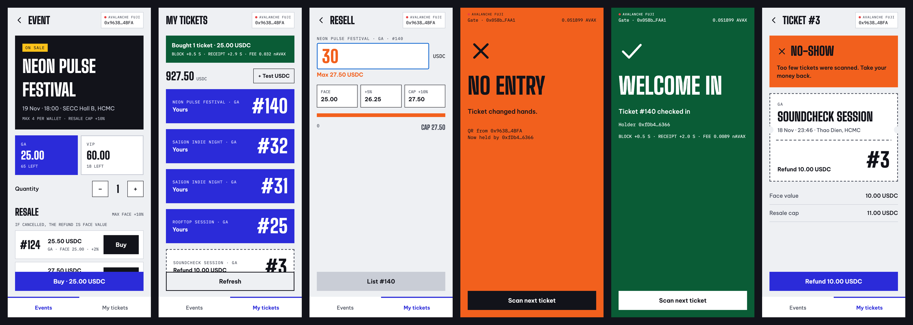

# Vé Gốc: concert tickets whose resale price is capped on chain at face value +10 %

Slides: _link to be added before submission_ ([outline](docs/SLIDES.md)) · Video (2 to 3 min): _link to be added before submission_ ([beat list](DEMO_FLOWS.md))

Diamond VIP tickets for BIGBANG's Hanoi shows (24 and 25 Oct 2026, [CafeF](https://cafef.vn/chinh-thuc-cong-bo-seat-map-va-gia-ve-concert-bigbang-o-ha-noi-dat-xat-ra-mieng-cao-nhat-105-trieu-dong-188260803093946955.chn)) had a face value of 9.8 million VND and were advertised by resellers for 45 million, about 4.6 times ([DTiNews, 13 Aug 2026](https://dtinews.dantri.com.vn/print/20260813142023123.htm)). Vé Gốc ("face-value ticket") makes the ticket an NFT that only changes hands through a built-in market, at face value +10 % at most, and the seller does not choose the buyer: the next ticket listed goes to the first wallet in line. Ticket money waits in an escrow vault. A cancelled show, or a show that never opens its gate, pays every buyer back from that vault. Entry is a QR signed by whoever holds the ticket right now, so a QR made before a resale stops working.

Live on Avalanche Fuji (testnet). Built from 2 to 19 Nov 2026 for Team1 Vietnam UniHack 2026, topic 9 "Capped-resale NFT tickets with yielding float".




Every image above was captured on Fuji on 19 Nov 2026. The counts in the images and in this file are the ones read from chain at capture and stored under `atCapture` in [`docs/fuji-run.json`](docs/fuji-run.json): on Neon Pulse Festival 101 tickets issued, 22 resales, 54 check-ins. Of those, 94 tickets, 15 resales and 50 check-ins are sample activity created by [`scripts/fuji-seed.mjs`](scripts/fuji-seed.mjs) with real transactions from 40 script wallets; the measurement script and the flow shown in the images made the rest.

## Live on Fuji (chain 43113)

| Contract | Address | Verified |
|---|---|---|
| VeGoc (events, tickets, market, waitlist, gate, refunds) | [`0x6f5802cdeea534b66067607875e2e284fec93ef2`](https://testnet.snowtrace.io/address/0x6f5802cdeea534b66067607875e2e284fec93ef2) | yes (Routescan / Snowtrace) |
| FloatVault (escrow, mock yield from each event's funded reserve) | [`0x74fb6051201c3e0cdf2d37b1753ae35d51360a06`](https://testnet.snowtrace.io/address/0x74fb6051201c3e0cdf2d37b1753ae35d51360a06) | yes |
| MockUSDC (test token, 6 decimals, faucet) | [`0x0c13cf96d2b8ebaafc32e8ab4449962d4adc28eb`](https://testnet.snowtrace.io/address/0x0c13cf96d2b8ebaafc32e8ab4449962d4adc28eb) | yes |
| Safe v1.4.1, 2 of 3 owners (organizer of events 0, 2, 5; receives the 3 % platform fee) | [`0x96aDD8A7c64d93818cc71eb6E97Db478a091bc41`](https://testnet.snowtrace.io/address/0x96aDD8A7c64d93818cc71eb6E97Db478a091bc41) | canonical Safe proxy ([created here](https://testnet.snowtrace.io/tx/0x68040446ded82594b72d3f65f80db922c88e0bfbded87c7c517da193359fe3e5)) |

The same code is deployed a second time against Circle's own test USDC, [`0x5425890298aed601595a70AB815c96711a31Bc65`](https://testnet.snowtrace.io/address/0x5425890298aed601595a70AB815c96711a31Bc65): VeGoc [`0xe5c2aa021be8bc725b35a6e9cd30ab8e43c6ebeb`](https://testnet.snowtrace.io/address/0xe5c2aa021be8bc725b35a6e9cd30ab8e43c6ebeb), FloatVault [`0x426174f593a19db398131b84d62a3b9eef23f7e4`](https://testnet.snowtrace.io/address/0x426174f593a19db398131b84d62a3b9eef23f7e4), both verified. One event ran there from sale to settlement and one is on sale until 6 Dec.

Deployed at block 61300554 by `0xA52C09A9F0E0Dc256a2454934782468880226FB2` ([VeGoc deploy tx](https://testnet.snowtrace.io/tx/0xa41f4ebf2ddec4dcf8eb30ca684482accfbdcee77d10c601d51c9cea5de2e59c)). Every transaction hash quoted here, and the full list of what ran, is in [`docs/FUJI.md`](docs/FUJI.md) and the JSON files next to it.

| # | Event | Organizer | State on 19 Nov 2026 |
|---|---|---|---|
| 0 | Neon Pulse Festival, 12 to 13 Dec, GA 25 / VIP 60 USDC, max 4 per wallet | Safe | on sale: 101 issued, 22 resales, 54 scanned in advance, 3 VIP listed, one purchase relayed for a wallet holding no AVAX |
| 1 | Saigon Indie Night, 5 Dec | organizer wallet | on sale, 12 sold; one ticket resold to the first wallet in line |
| 2 | Rooftop Session | Safe | ended with the gate quorum met (9 of 16 scanned), not settled yet |
| 3 | Hanoi Lantern Night, 30 Nov | organizer wallet | cancelled, all 5 tickets refunded in one transaction |
| 4 | Soundcheck Session | organizer wallet | ended with nobody scanned: no-show, refunds open, settlement locked until 21 Nov 04:02 (+07) |
| 5 | Warm-up Set | Safe | ended with 4 of 6 scanned, settled by two Safe owners |

Checks anyone can run (`B=0x6f5802cdeea534b66067607875e2e284fec93ef2`, `R=https://avalanche-fuji-c-chain-rpc.publicnode.com`, `H=0x1686208853AfDEDAE5133E12BcB7c4a87215a8D5` holds ticket 142, a GA ticket):

| Rule | Command | Answer |
|---|---|---|
| No transfer outside the market | `cast call $B 'transferFrom(address,address,uint256)' $H 0x9638F49A3cB7c002779724b427905F6Ab1D54BFA 142 --from $H --rpc-url $R` | reverts `0xf90e674a` = `TransferBlocked()` |
| Resale cap | `cast call $B 'list(uint256,uint256)' 142 27500001 --from $H --rpc-url $R` | reverts `AboveCap(27500000)` |
| QR valid 5 minutes at most | `cast call $B 'checkIn(uint256,uint256,bytes)' 142 1900000000 0x00 --from 0x058b326D8A3B7f69FAC9cFB0a772a63e4d26FAA1 --rpc-url $R` | reverts `0x48f0fae6` = `DeadlineTooFar()` |
| No-show: organizer locked out | `cast call $B 'settle(uint256,address)' 4 0xA52C09A9F0E0Dc256a2454934782468880226FB2 --from 0xA52C09A9F0E0Dc256a2454934782468880226FB2 --rpc-url $R` | reverts `DisputeWindow(1795208540)` until 20 Nov 21:02 UTC |
| Escrow is whole | `cast call 0x74fb6051201c3e0cdf2d37b1753ae35d51360a06 'totalPrincipal()(uint256)' --rpc-url $R` plus `reserve()` | equals the vault's USDC balance |

## Measured on Fuji

Three rounds on 19 Nov 2026 (+07) with [`scripts/measure.mjs`](scripts/measure.mjs); medians, raw rows in [`docs/fuji-measure.json`](docs/fuji-measure.json). Each transaction is signed first and the clock starts when it is sent. "In a block" is the block's own millisecond timestamp (Avalanche blocks carry `timestampMilliseconds`) minus the send time. "Receipt" is when the script held the receipt from a public RPC polled every 100 ms.

| Action | Tx | Gas | In a block after | Receipt after | Fee at the C-Chain mainnet base fee* |
|---|---|---|---|---|---|
| Buy 1 GA ticket with MockUSDC: permit and purchase in one transaction | [0xe2d6…9831](https://testnet.snowtrace.io/tx/0xe2d6552ce87a44c8163417ff683a93d9e8151fd0628c147c5e8c7dc75ac69831) | 216,655 | 0.8 s | 3.2 s | 0.0016 AVAX |
| List for resale at the cap, nobody in line | [0x2c15…8fad](https://testnet.snowtrace.io/tx/0x2c15bba88037a65587b0bd37b069b245566f610084814c5a55163050b7788fad) | 98,348 | 0.5 s | 2.1 s | 0.0007 AVAX |
| Buy the resale listing (permit and purchase) | [0x91b5…df8d](https://testnet.snowtrace.io/tx/0x91b58c68423d77fa8174d2056aa86c479e49fcbb94c06ea126709cbc08f7df8d) | 168,555 | 0.4 s | 2.4 s | 0.0013 AVAX |
| Join the GA line, deposit = the cap (permit and deposit) | [0x3107…7efe](https://testnet.snowtrace.io/tx/0x3107a9201d883d6781473ac997274cab0e37bd7f5bebd050ed6f259a5b7f7efe) | 228,720 | 0.3 s | 2.4 s | 0.0017 AVAX |
| List at the cap, sold to the first in line in the same transaction | [0x344d…2ed5](https://testnet.snowtrace.io/tx/0x344dc70a6c7cd13c8d0c9572e1c75a066145b6d853687caf80e1827b9ca22ed5) | 207,029 | 0.6 s | 2.7 s | 0.0016 AVAX |
| Gate check-in | [0x22af…2a33](https://testnet.snowtrace.io/tx/0x22afaa2761f59104d04e3b3f212e6825e14637da32b6b154e59840716e952a33) | 55,870 | 0.3 s | 2.5 s | 0.0004 AVAX |
| Buy 1 ticket with **Circle's USDC** (permit and purchase, second deployment, not the first purchase of the event) | [0x419f…6d1c](https://testnet.snowtrace.io/tx/0x419f4a848a188ca9b9931cb37159bf00cb26e8cac9acd53f2bfc23840a9d6d1c) | 255,310 | | | 0.0019 AVAX |
| Same, the first purchase ever on that deployment (cold storage, two tickets) | [0x345a…6464](https://testnet.snowtrace.io/tx/0x345a752b021933803c739978f4e7617e06db07af4be2c99bd17e61f6dc446464) | 408,208 | | | 0.0031 AVAX |
| Relayed purchase: the relayer pays the gas, the buyer holds no AVAX (`buyFor`) | [0xbeff…0bd3](https://testnet.snowtrace.io/tx/0xbeffd30b731de53c4f956a13f665c5486e0b656c716e40214372f3463a550bd3) | 282,590 | | | 0.0021 AVAX |

\* gas × 7.509 nAVAX, the base fee `cast base-fee --rpc-url https://api.avax.network/ext/bc/C/rpc` returned when the script ran. The Fuji transactions paid 160 wei per gas (10 wei base fee plus a 150 wei tip), so Fuji fees say nothing about real cost. Circle's USDC is an upgradeable proxy that also checks a blocklist on every transfer, which is part of why its purchase costs more gas than the mock's; the business model below uses the Circle figure.

The chain put each transaction in a block 0.3 to 0.8 s after it was sent (medians). The remaining two seconds or so are the public RPC serving the receipt. The app prints both numbers and the fee on every confirmation, for example `BLOCK +0.5 S · RECEIPT +2.4 S · FEE 0.035 nAVAX`.

## What it does

| | Guest (mobile app, `app/`) | Organizer (web console, `admin/`) |
|---|---|---|
| Event | browse events, tiers, seats left | create an event with up to 4 tiers and a per-wallet limit |
| Buy | pay USDC in one transaction through an EIP-2612 permit | issue free tickets (entry only, never resellable) |
| Resale | list at any price up to face +10 %; join a tier's line (deposit = the cap) and get the next ticket listed; leave the line and take the deposit back | listings, people in line, resale count, volume, average price against face |
| Gate | holder shows a signed QR, valid 3 minutes in the app (the contract allows 5 at most); gate staff check in on chain | grant or revoke gate wallets; gate quorum counter; extend a running event by up to 24 h |
| Money | refund button after a cancel or a no-show | float and mock yield live; cancel and refund every holder; settle after the show, minus the 3 % fee |
| Safe | | an event organized by a Safe needs two owners for each organizer action: the first approves, the second executes |

## How it works

- Tickets are ERC-721. `_update` lets a held ticket move only inside the market, so `transferFrom` between holders reverts. A checked-in ticket never moves again.
- `list` reverts above `face × 11000 / 10000`. While anyone is in the tier's line, `list` sells the ticket to the first in line in the same transaction, paid from that wallet's deposit, and `buyListing` reverts `WaitlistFirst`. Joining the line needs the full cap as a deposit and is closed while a listing is open (`ListingsOpen`). A seller therefore cannot hand the ticket to a customer who paid a premium off chain while anyone else is waiting.
- `buyFor` takes the buyer's EIP-712 `Buy(buyer, eventId, tier, quantity, nonce, deadline)` signature and the buyer's USDC permit, so anyone can send the purchase and pay its gas. The ticket and the payment are the buyer's.
- A ticket can only be held by an address without code, and `checkIn` accepts an ECDSA signature from that address only (no ERC-1271). A contract that holds a ticket could be sold for any price without the ticket moving; here it cannot receive one. Smart-contract wallets (Safe, ERC-4337, EIP-7702) are refused as holders for the same reason; relayed purchases give a plain wallet the "no gas coin needed" part instead.
- The entry QR carries the EIP-712 message `CheckIn(uint256 tokenId,uint256 deadline)` under the domain `{name: "VeGoc", version: "1", chainId, verifyingContract}`, signed by the holder. `checkIn` compares the signer with `ownerOf` at that moment, refuses a deadline more than 5 minutes ahead, and closes when the event ends.
- Primary-sale USDC goes to FloatVault under the event id. Gate scans double as proof that the show happened. With at least half of the paid tickets scanned by the end, the organizer can `settle` at once: 3 % of the principal goes to the platform's `feeRecipient`, the rest and the event's mock yield to the organizer. Below half, the event is a no-show: holders of unscanned tickets take face value back (`claimRefund`, or anyone calls `refundMany` for them) and `settle` stays locked for 48 hours. If the gate was down, the organizer can `extendEvent` by up to 24 hours in total before the end so scanning continues.
- After `cancelEvent` every holder can be refunded and the organizer can only take the yield accrued up to the cancel. Refunds are the face value the organizer received; a resale premium already went to the seller.
- There is no owner, pause or upgrade key in either contract.

Diagrams, state machines, role matrix and the threat model, including what the round-1 and round-2 security reviews found: [docs/ARCHITECTURE.md](docs/ARCHITECTURE.md).

## Who else does this, and what is different

| Product | What it does | Where the rule lives |
|---|---|---|
| Ticketmaster SafeTix | rotating barcode "tied directly to a verified fan account"; transfers only inside Ticketmaster ([Ticketmaster](https://business.ticketmaster.com/safetix/), [404 Media on the DOJ complaint, 21 Aug 2024](https://www.404media.co/ticketmaster-used-revolving-barcodes-to-control-ticket-resale-market-and-surveil-customers-doj-alleges/)) | the company's servers and app |
| Ticketbox resale (Vietnam) | official resale channel since Dec 2025; the buyer gets a new QR; no price cap or fee is published ([Ticketbox, 11 Dec 2025](https://www.threads.com/@ticketbox.vn/post/DSJrerOjsaZ/), [3 Mar 2026](https://www.threads.com/@ticketbox.vn/post/DVazeryj0jq/)) | the platform |
| CTicket REAL FAN (Vietnam) | artist quiz in place of a CAPTCHA and an IP filter at purchase, used for the BIGBANG sale ([VietNamNet, 21 Aug 2026](https://vietnamnet.vn/en/bigbang-hanoi-ticket-rush-puts-cticket-technology-to-the-test-2547749.html)) | the platform; it acts at purchase, resale happened anyway |
| OPEN, formerly GET Protocol | NFT tickets for ticketing companies, each sale, resale and scan recorded on Polygon ([docs, 10 Jun 2025](https://docs.onopen.xyz/docs/token-economics-overview)) | the docs do not say who enforces resale rules |
| Dreamus / SK Planet on an Avalanche subnet | NFT tickets in OK Cashbag; a maximum resale price can be set per collection ([Avalanche, 21 Sep 2023](https://www.avalanche.com/blog/korean-entertainment-giant-powers-ticketing-platform-with-avalanche), [Decrypt](https://decrypt.co/198091/south-koreas-dreamus-puts-nft-tickets-avalanche-events-kpop-concerts)) | the collection contract, on their own chain |
| UK law | resale above face value is to become illegal; not law yet on 24 Aug 2026 ([gov.uk, 19 Nov 2025](https://www.gov.uk/government/news/government-bans-ticket-touting-to-protect-fans-from-rip-off-prices), [Full Fact](https://fullfact.org/government-tracker/ticket-resales-consumer-protections/)) | legislation |

Capped NFT resale exists already. Four things here were not in the products above when we looked:

1. The gate QR is a signature by the wallet that owns the ticket at scan time, checked by a public contract. Any gate app can verify it, and the organizer cannot quietly change the rule.
2. The seller does not pick the buyer. A public on-chain line takes the next ticket listed, which removes the "list it the second my customer is ready" trick behind most side deals.
3. Those same gate signatures decide who gets the money. Below a scan quorum of one half the buyers can refund and the organizer waits; at or above it the organizer is paid at once. The no-show case needs no arbiter.
4. The platform fee is taken only from money that is paid out to an organizer. A cancelled or no-show event costs the buyer nothing and earns the platform nothing.

In Vietnam today points 3 and 4 are switched off, because they need the USDC escrow (see the law row below). Points 1 and 2, the cap and the transfer block stay.

## Business model

The platform takes 3 % of each settled event's primary sales (`feeBps = 300`, fixed at deployment, paid by `settle` to the Safe). Resale carries no fee today. The organizer keeps the float yield where the escrow is legal. In Vietnam, where the escrow is off, the same 3 % is invoiced to the organizer in VND.

Worked example for a 10,000-seat show at an average of 2,000,000 VND per ticket (our assumption; BIGBANG's Hanoi tiers ran from 1 to 10.5 million VND, [CafeF, 3 Aug 2026](https://cafef.vn/chinh-thuc-cong-bo-seat-map-va-gia-ve-concert-bigbang-o-ha-noi-dat-xat-ra-mieng-cao-nhat-105-trieu-dong-188260803093946955.chn)):

| Item | Amount |
|---|---|
| Ticket sales | 20 billion VND (about 779,700 USDC at the State Bank's central rate of 25,652 VND on 17 Nov 2026, [VietnamBiz](https://vietnambiz.vn/ty-gia-trung-tam-len-cao-ky-luc-cac-chuyen-gia-du-bao-phai-sang-nam-2027-moi-ha-nhiet-20261118121443876.htm)) |
| Platform fee, 3 % | 600 million VND |
| Gas for 10,000 purchases and 10,000 check-ins | 23.4 AVAX at the mainnet base fee measured above (255,310 gas for a Circle-USDC purchase + 55,870 for a check-in, × 10,000 × 7.509 nAVAX); sending purchases through the relayer (`buyFor`) adds about 66,000 gas each (mock-token rows above); paid by the platform out of the fee |
| Float yield for the organizer, where the USDC escrow is legal | 112 to 204 million VND for 60 days at 3.4 to 6.2 % a year, the range of Aave v3's USDC supply rate on Avalanche over 12 to 18 Nov 2026 ([Aavescan](https://aavescan.com/avalanche-v3/usdc)) |

Market size: Ticketbox alone sold more than 1 million concert and music-festival tickets in Vietnam in 2025 ([VOV, 17 Dec 2025](https://kynguyenvuonminh.vov.vn/en/culture/entertainment-market-rebounds-as-concert-ticket-sales-top-1-million-post1254647.vov), citing Ticketbox; other channels not counted). At the same assumed 2,000,000 VND average, 3 % of that is about 60 billion VND a year. No organizer or venue has seen Vé Gốc yet.

For comparison, Eventbrite lists 3.7 % plus 1.79 USD per ticket and 2.9 % payment processing in the US ([pricing page](https://www.eventbrite.com/organizer/pricing/)). Ticketbox's organizer terms set the fee per contract and publish no percentage.

## Rules compliance

| Question | Answer |
|---|---|
| Why on-chain | The resale cap, the waitlist order, the ban on off-market transfers, the escrow and the refund rules are code that neither the organizer nor the platform can change after a sale. A buyer can read on Snowtrace that the money is still in the vault. A platform rule, as at Ticketmaster or Ticketbox, holds only inside that platform and can be changed by it. |
| Why Avalanche | A gate needs an answer while the guest stands there: on Fuji the check-in was in a block 0.3 s after sending and the receipt was in hand after 2.5 s (table above). At the mainnet base fee a purchase with Circle's USDC costs 0.0019 AVAX and a check-in 0.0004 AVAX. Circle issues USDC natively on the C-Chain and on Fuji, and this repo runs against it. The canonical Safe contracts are deployed on both. The console's activity feed gets its first paint from the Avalanche Data API. A venue that wants gas-free scans and its own scanner allow-list can move to an Avalanche L1; a design is in [ARCHITECTURE.md](docs/ARCHITECTURE.md#an-avalanche-l1-for-venues-designed-not-deployed), not deployed. |
| Where the money comes from | Buyers pay face value in USDC. It waits in FloatVault. After a show that happened, 97 % goes to the organizer and 3 % to the platform. Resale money goes from buyer to seller; a waitlist deposit goes to the seller when the line gets a ticket, and any unused part back to the waiting wallet. |
| Where the yield comes from | Mock in this demo: FloatVault accrues a fixed 5 % a year on each event's principal (`principal × 500 / 10000 × seconds / 365 days`) and pays it from that event's own reserve, funded beforehand with test USDC by the organizer wallet. Nothing is minted. In production the vault would be an ERC-4626 wrapper over USDC supplied to Aave v3 on the C-Chain, where the yield is interest paid by borrowers. That vault is not built. No token of our own exists or is planned. |
| Vietnamese law | Crypto assets are not a lawful means of payment in Vietnam (the State Bank's position, reported by [Báo Hà Tĩnh, 8 Mar 2025](https://baohatinh.vn/dong-tien-pi-co-duoc-su-dung-vao-hoat-dong-thanh-toan-khong-post283898.html)); in the same article a lawyer comments that using them to pay can be fined 50 to 100 million VND under Decree 88/2019, Art. 26, as amended by Decree 143/2021. Law 71/2025/QH15 on the digital technology industry, in force since 1 Jan 2026, recognises digital assets as property and excludes "digital forms of fiat money" from crypto assets (Art. 47, [text](https://english.luatvietnam.vn/lawonthedigitaltechnologyindustryno71-2025-qh15datedjune142025ofthenationalassembly-405695-doc1.html)). Resolution 05/2025/NQ-CP (9 Sep 2025) pilots a crypto-asset market in which offering, trading and payment must be in Vietnamese dong through providers licensed by the Ministry of Finance (Art. 4(7), Art. 7, [text](https://xaydungchinhsach.chinhphu.vn/toan-van-nghi-quyet-so-5-2025-nq-cp-ve-trien-khai-thi-diem-thi-truong-tai-san-ma-hoa-tai-viet-nam-119250909184045221.htm)); no licence had been confirmed as of 15 Sep 2026 ([Finwire](https://finwire.io/news/crypto-news/vietnam-targets-first-crypto-asset-provider-licences-in-2026)). So in Vietnam today tickets would be sold in VND through a licensed payment intermediary and the USDC escrow is off. With it go the automatic refunds, the no-show rule and the on-chain 3 % fee: refunds are paid in VND by the intermediary and the fee is invoiced to the organizer in VND. What stays on chain is the ticket ledger: the resale cap, the waitlist, the transfer block and the gate QR. The VND payment leg is not built. The USDC escrow and yield apply only where paying for a ticket in a stablecoin is legal. We found no Vietnamese guidance on NFT tickets. No personal data is stored on chain; event name, venue and times are public. This demo takes no real money. We have not had a legal review. |
| Custody (rule L3) | Ticket money is pooled in FloatVault, which topic 9 allows. No key can move it freely: the vault obeys only VeGoc, and VeGoc pays it to ticket holders (cancel, no-show) or, after a show that met the gate quorum or after the 48-hour hold, to the event's organizer and the platform. Neither contract has an owner. The showcase events 0, 2 and 5 are organized by a 2-of-3 Safe (canonical v1.4.1), which also receives the platform fee, so releasing that float takes two signers; event 5 was settled that way on Fuji. **On testnet the three Safe owners are team keys on one laptop** (owner 1 is the organizer wallet; owner 1 and owner 2 sit in the same gitignored `.env.fuji`), so the Safe demonstrates the two-signer flow, not independent custody; for a real launch the owners would be the platform, the organizer and an independent party on separate devices. Events 1, 3 and 4 are organized by one wallet on purpose, to show cancel, refund and no-show. The contract cannot tell a multisig from another contract, so "organizers must be Safes" is a listing policy of the app, not an on-chain rule. The quorum that releases the float can be bought: an organizer who buys half of the paid tickets with their own wallets and scans them is paid at once, and since they get their own money back the attack costs them only the 3 % fee on those tickets. If the gate fails at a real show and fewer than half are scanned, every unscanned holder can refund unless the organizer extends the event in time. |
| Wallets and gas | Guests hold tickets in their own wallet; the platform holds no keys for them. This demo build embeds three throwaway test keys (Guest A, Guest B, Gate staff) with a wallet switcher, on chains 31337 and 43113 only, and those wallets pay their own gas in test AVAX. `buyFor` lets a relayer pay the gas for a purchase the buyer signed; it ran once on Fuji for a wallet holding no AVAX (table above), with the gate wallet standing in for the platform's relayer. Relayed listing, waitlist and check-in, a hosted relayer and an embedded wallet with phone sign-in are not built. |
| Mocks and dev toggles | (1) MockUSDC with a public faucet on the main deployment; the second deployment uses Circle's USDC. (2) Mock yield at a fixed 5 % a year from each event's pre-funded reserve. (3) Three embedded test keys with a wallet switcher. (4) On the web build the gate pastes the QR payload; the native app scans with the camera. (5) Events 2, 4 and 5 were created to end minutes after seeding, so settlement and the no-show can be shown. (6) The audience on events 0 to 5 is sample activity from 40 script wallets; event 0 was scanned before its start date for the same reason. (7) Tickets on the Circle USDC deployment cost 0.05 USDC, because the test USDC came from a small Pangolin pool. |

## Run locally

Needs Foundry, Node 22 or newer, and Chrome (for the end-to-end tests).

```sh
git clone --recurse-submodules https://github.com/buiPhongGiang/ticketing.git && cd ticketing
forge build && forge test

# Terminal 1: anvil + contracts + 3 demo events, writes app/.env.dev and admin/.env.dev
./scripts/dev-chain.sh
# Terminal 2: sample purchases
./scripts/demo-seed.sh

# Terminal 3: guest app (Expo web) on http://localhost:8081
cd app && npm ci && npm run web

# Terminal 4: organizer console on http://localhost:8093
cd admin && npm ci && npx vite --mode dev --port 8093
```

The app switches between Guest A, Guest B and Gate staff from the address chip (top right). The console needs a browser wallet on the local chain (RPC `http://127.0.0.1:8545`, chain 31337) with anvil's public test key #0, which is the organizer. Never use that key on a real network.

Against Fuji: `cd app && ENV_FILE=.env.fuji npm run web` and `cd admin && npx vite --mode fuji --port 8093`. The env files come from the deployment steps, which need a gitignored `.env.fuji` with `FUJI_RPC`, `TICKET_ORGANIZER_*`, `GUEST_A_*`, `GUEST_B_*`, `GATE_*`, `SAFE_OWNER_2_*`, `SAFE_OWNER_3_*` (`_ADDRESS` and `_KEY`), `SAFE_ADDRESS` and `SEED_MNEMONIC`, holding test AVAX from the [faucet](https://build.avax.network/console/primary-network/faucet):

```sh
node scripts/fuji-safe.mjs      # 2-of-3 Safe from the canonical contracts on Fuji (once)
./scripts/fuji-deploy.sh        # deploy, verify, write env files; USDC_ADDRESS=<token> ENV_SUFFIX=-usdc uses an existing token
node scripts/fuji-seed.mjs      # six events and about 300 transactions of sample activity (16 minutes)
node scripts/fuji-usdc.mjs      # the Circle USDC run on the second deployment (12 minutes)
node scripts/measure.mjs        # the table above
node scripts/pre-record.mjs     # read-only check before a recording or a live demo
```

## Tests

| Suite | Command | Count | What it covers |
|---|---|---|---|
| Contracts | `forge test` | 69 (3 fuzz) | every money path: USDC into the vault, wallet limit, tier supply, permit purchase, relayed purchase (`buyFor`: relayer pays, cannot change the order, wallet limit), transfer block, cap (fuzzed), resale payment, price-change guard, waitlist (order, deposit, leave, credit, contracts refused, no buying past the line, fuzzed solvency), check-in by the current holder only, replay, 5-minute QR ceiling, gate extension, contracts refused as holders, free tickets not resellable, cancel and refunds, no-show refunds and the 48-hour lock, half quorum from paid tickets only, settle with the fee, yield from each event's own reserve and frozen at cancel, vault solvency (fuzzed), event validation, the review attacks of rounds 1 and 2 with their residuals |
| Contracts on a Fuji fork | `FUJI_RPC_URL=https://avalanche-fuji-c-chain-rpc.publicnode.com forge test --match-path 'test/*Fork*'` | 4 | Circle's real USDC: permit purchase, capped resale, check-in, settlement with the fee, cancel and refund, funded yield reserve; a real Safe v1.4.1 as organizer, one owner alone refused |
| App chain layer | `cd app && npm test` | 57 (against a real anvil and pure) | permit checkout, permit for a token with EIP-712 version "2", cap refused before signing, resale pays the seller, waitlist join and sale to the line, old QR refused, single entry, refund, no-show refund, free ticket not listable, organizer filter, QR over 5 minutes refused, faucet cooldown, race for the last ticket, journal recovery, fee, time and date formatting |
| App end to end | `cd app && npm run e2e` | 4 | Chrome at 390×844 on Expo web against anvil: buy, resell, resale buy, waitlist, old QR refused, entry, replay refused; cancel and refund; faucet cooldown |
| Console logic | `cd admin && npm test` | 33, plus 1 against live Fuji with `FUJI_RPC_URL` | formatting, error mapping, event status and quorum, ticket wall, CSV, resale stats, yield projection, settle states, form validation, login, log index against a real anvil, Data API shortcut, Safe verification (a fake Safe is refused), Safe signatures |
| Console end to end | `cd admin && npm run e2e` | 13 | Chrome with an injected test wallet on anvil: login, create event, free tickets, gate staff, sales in float and activity, cancel and refund all, settle with the fee after the quorum, no-show lock and refunds |

The unit suites start anvil on a port the system assigns, so two runs do not collide.

## Repository map

| Path | What is there |
|---|---|
| `src/VeGoc.sol` | events, ERC-721 tickets, market, waitlist, relayed purchase, gate, refunds, settlement |
| `src/FloatVault.sol`, `src/MockUSDC.sol` | per-event escrow with mock yield from per-event reserves; test token |
| `test/` | Foundry tests (`VeGoc.t.sol`, `Market.t.sol`), the review regressions (`Regression.t.sol`), fork tests, test doubles in `test/mocks/` |
| `script/Deploy.s.sol`, `scripts/` | deployment; Fuji Safe, seed, Circle USDC run, measurement, pre-record check; local chain |
| `app/` | guest and gate app (Expo, React Native); `src/lib` is the chain layer with the transaction journal |
| `admin/` | organizer console (Vite, React); `src/safe.ts` Safe verification, `src/logs.ts` activity index, `src/model.ts` pure rules |
| `docs/` | architecture and threat model, Fuji transactions (`FUJI.md`), slide outline, images, deployment and run records |
| `DEMO_FLOWS.md` | the demo beats with captions, recording settings and the pre-record checklist |

## Limits and roadmap

- Not audited. Testnet only.
- The cap binds the on-chain price. When nobody is in line, a listing is open to the first taker, so a scalper's named customer can still win the race and pay the premium off chain. Selling a whole wallet's private key also stays possible. The per-wallet limit, the 5-minute holder-signed QR and the public line raise the cost; purchase-time anti-bot checks are not built.
- An organizer who buys half of the paid tickets through their own wallets and scans them can fake the gate quorum for a show that never happened, at the cost of the 3 % fee on those tickets. A dispute process would be needed on top.
- If the gate fails at a real show and the organizer does not `extendEvent` before the end, every unscanned holder of a show that did happen can take a refund.
- `checkIn` closes at the end but does not wait for the start; the seeded showcase was scanned before its start date. A production contract should open the gate a few hours before `startsAt`.
- Gate staff are trusted: a staff wallet holding a fresh QR could check that ticket in without the guest.
- The three Safe owner keys are team keys on one machine (see the custody row).
- Smart-contract wallets cannot hold tickets. A plain wallet can buy without gas through `buyFor`; an embedded wallet with phone sign-in and a hosted relayer are not built.
- `ticketsOf`, `listings`, `getEvents` and `waitlistPlace` are linear view functions. They are fine at this scale; an indexer is needed for large events.
- Anyone can create an event on the contract. The app lists only configured organizers.
- Roadmap: VND payment partner, embedded wallet and hosted relayer, Aave v3 vault where the escrow is legal, resale royalty for the artist, a gate that opens a few hours before the start, the venue L1.

## Team and license

buiPhongGiang. MIT license, see [LICENSE](LICENSE).
