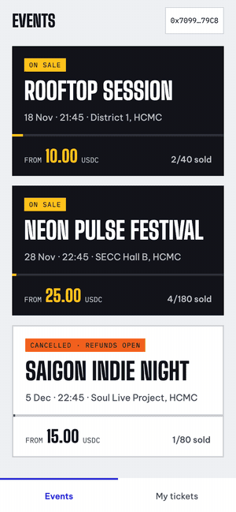

# Ticketing: capped-resale NFT tickets on Avalanche

Concert tickets in Vietnam get resold at 3–5× face value. Here every ticket is an NFT bought with USDC, it can only be resold through the built-in market at **face value +10 % at most**, ticket money waits in an escrow vault until the show is over, and a cancelled show refunds every buyer from that vault. Entry is a QR signed by whoever holds the ticket right now, so a QR made before a resale stops working.

Live on **Avalanche Fuji**. Built for Team1 Vietnam UniHack 2026, topic 9 "Capped-resale NFT tickets with yielding float".




## Live on Fuji (chain 43113)

| Contract | Address | Verified |
|---|---|---|
| TicketBox (events, tickets, market, gate, refunds) | [`0x9516fd269065a17ffd5004df8141373a84161d6e`](https://testnet.snowtrace.io/address/0x9516fd269065a17ffd5004df8141373a84161d6e) | yes (Routescan / Snowtrace) |
| FloatVault (escrow, mock yield) | [`0x1b55bc51999057b46b65df6b2f7b93254d2aff2e`](https://testnet.snowtrace.io/address/0x1b55bc51999057b46b65df6b2f7b93254d2aff2e) | yes |
| MockUSDC (test token, 6 decimals, faucet) | [`0x36ab0ba0c58bcfd329bc105542faf376c43214aa`](https://testnet.snowtrace.io/address/0x36ab0ba0c58bcfd329bc105542faf376c43214aa) | yes |

Deployed at block 61289451 by the organizer wallet `0xA52C09A9F0E0Dc256a2454934782468880226FB2` ([deploy tx](https://testnet.snowtrace.io/tx/0x2d4e4e9cc2a3b1d3f46e583ee9abe2c82eb15b682b97229dea925eb14a968d72)). Demo events on chain: `0` Neon Pulse Festival (GA 25 USDC / VIP 60 USDC, max 4 per wallet), `1` Saigon Indie Night, `2` Rooftop Session (already ended, used to show settlement).

Measured on Fuji on 18 Nov 2026 with [`measure.mjs`](scripts/measure.mjs) (time = send to receipt, including RPC polling):

| Action | Tx | Gas | Time to receipt | Fee on Fuji | Fee at C-Chain mainnet gas price* |
|---|---|---|---|---|---|
| Buy 1 GA ticket with USDC | [0xc131…119d](https://testnet.snowtrace.io/tx/0xc13153eeb808f26329fb658202f63e8910ae1a1aaf045212557fbe1e968e119d) | 176,098 | 2.9 s | 0.00000000003 AVAX | 0.0013 AVAX |
| List for resale at the cap | [0xca85…cb1](https://testnet.snowtrace.io/tx/0xca85fb871f0d68f961672d98a04c76c624b65fd4856e7a3a499bc37c76b30cb1) | 82,841 | 2.6 s | 0.00000000001 AVAX | 0.0006 AVAX |
| Buy the resale listing | [0x94b1…a8f](https://testnet.snowtrace.io/tx/0x94b1ea2372b56a05028aa9f0568d8ca5a7c7bc105da93edfb1c4017a126b2a8f) | 143,001 | 3.2 s | 0.00000000002 AVAX | 0.0011 AVAX |
| Gate check-in | [0x0e85…6ea8](https://testnet.snowtrace.io/tx/0x0e850b79af6996b61c4d1f12331aaf9730cf310e4dbce1deed575da619166ea8) | 52,743 | 2.6 s | 0.000000000008 AVAX | 0.0004 AVAX |

\* gas × 7.5 gwei, the price `eth_gasPrice` returned on `api.avax.network` on 18 Nov 2026. Fuji's base fee was a few wei that day, so the Fuji column is not a realistic cost.

## What it does

| | Guest (mobile app, `app/`) | Organizer (web console, `admin/`) |
|---|---|---|
| Event | browse events, tiers, seats left | create an event with up to 4 tiers and a per-wallet limit |
| Buy | pay USDC; one transaction thanks to an EIP-2612 permit | issue free comps |
| Resale | list at any price up to face +10 %, buy listings, unlist | see listings, resale count, volume, average price vs face |
| Gate | holder shows a signed QR valid 3 min; gate staff check in on chain | grant or revoke gate wallets per event |
| Money | refund button when an event is cancelled | float and mock yield live; cancel → refund every holder in one transaction; settle after the show |

Every transaction screen links to Snowtrace and shows the network fee actually paid.

## How it works

```
buyer ──USDC──▶ TicketBox ──▶ FloatVault (per-event principal, mock 5 % APR)
                    │                │
            ERC-721 ticket     after the show: principal + yield → organizer
                    │          after a cancel: face value → each holder
 resale: buyer ──USDC──▶ seller (≤ face +10 %), ticket moves inside TicketBox only
 gate: holder signs CheckIn(tokenId, deadline) ─▶ staff calls checkIn ─▶ ticket locked
```

- **Transfers outside the market revert** (`TransferBlocked`): `_update` only lets a held ticket move inside `buyListing`. A checked-in ticket never moves.
- **Price cap in the contract**: `list` reverts above `face × 11000 / 10000`; `buyListing` takes a `maxPrice` so a seller cannot raise the price under a pending purchase.
- **Escrow**: primary-sale USDC goes straight to the vault under the event id. The organizer can only `settle` after `endsAt`; after `cancelEvent` they can only take the yield, never the principal.
- **Refunds**: `claimRefund(tokenId)` by the holder, or `refundMany(tokenIds)` by anyone (the console sends it right after cancelling). Refund = face value the organizer received; comps refund 0.
- **Entry**: the QR carries an EIP-712 signature by the current holder (EOA or ERC-1271). `checkIn` checks it against `ownerOf` at that moment, so a QR from a previous holder is refused, and a used ticket cannot be scanned twice.

Diagrams (architecture, sequences, state machine, threat model): [docs/ARCHITECTURE.md](docs/ARCHITECTURE.md).

## Rules compliance

| Question | Answer |
|---|---|
| Why on-chain | The resale cap, the ban on off-market transfers and the escrow are enforced by the contract, not by a company's terms. A scalper cannot list at 3× on a second site and hand the ticket over: the transfer reverts. Buyers can check on Snowtrace that their money is still in the vault. |
| Why Avalanche | The gate needs a final answer while the guest is standing there: we measured 2.6 s from sending a check-in to holding its receipt on Fuji, through a public RPC with 100 ms polling. At the mainnet gas price we read, a purchase costs about 0.0013 AVAX and a check-in about 0.0004 AVAX (table above), about 17 AVAX in gas for 10,000 purchases plus 10,000 check-ins. Circle's native USDC and Aave v3 (for the float) both run on the C-Chain. |
| Where the money comes from | Ticket buyers pay face value in USDC. It sits in FloatVault until the event ends, then goes to the organizer. Resale money goes from buyer to seller; the organizer and the platform take nothing on resale today (a capped resale royalty is on the roadmap). |
| Where the yield comes from | **Mock** in this demo: FloatVault accrues a fixed 5 % APR and mints mock USDC on settlement. In production the vault would be an ERC-4626 wrapper over USDC lent on Aave v3 on the Avalanche C-Chain, where yield is interest paid by borrowers. Nothing relies on a newly minted token. |
| Vietnamese law | Crypto assets are not legal tender in Vietnam and are not an accepted means of payment for goods and services. The 2025 Law on Digital Technology Industry recognises digital assets as property, not as money. So this testnet demo uses mock USDC only and takes no real money. A Vietnamese launch would sell tickets in VND through a licensed payment provider and use the chain as the ticket and escrow ledger, or run under a licensed crypto-asset service if the pilot framework allows it. Event metadata on chain is public (name, venue, times); no personal data is stored on chain. We have not had a legal review. |
| Custody | Non-custodial: guests hold tickets in their own wallet. The only pooled funds are ticket money in FloatVault, which only TicketBox can move, and only to the organizer after the show or to holders after a cancel. Production would put the organizer role behind a Safe multisig. |
| Mocks and dev toggles | (1) **MockUSDC** with a public faucet (1,000 per hour per wallet) instead of Circle USDC. (2) **Mock yield** at a fixed 5 % APR. (3) The app ships **three throwaway testnet keys** (Guest A, Guest B, Gate staff) with a wallet switcher, only on chains 31337 and 43113. (4) On the web build the gate pastes the QR payload instead of using the camera; the native app scans with the camera. (5) Event 2 was created with a 30-minute window so settlement can be shown on camera. |

## Run locally

Needs Foundry, Node 22+ and Chrome (for e2e).

```sh
git clone --recurse-submodules https://github.com/buiPhongGiang/ticketing.git && cd ticketing
forge build && forge test

# Terminal 1: anvil + contracts + 3 demo events, writes app/.env.dev and admin/.env.dev
./scripts/dev-chain.sh
# Terminal 2: sample purchases
./scripts/demo-seed.sh

# Terminal 3: guest app (Expo web) on http://localhost:8081
cd app && npm ci && npm run web

# Terminal 4: organizer console on http://localhost:8093
cd admin && npm ci && npx vite --mode dev --port 8093
```

The app switches between Guest A, Guest B and Gate staff from the address chip (top right). The console needs a browser wallet on the local chain (RPC `http://127.0.0.1:8545`, chain 31337) with anvil's public test key #0, which is the organizer. Never use that key on a real network.

Against Fuji: `cd app && ENV_FILE=.env.fuji npm run web` and `cd admin && npx vite --mode fuji --port 8093`. The env files are written by `./scripts/fuji-deploy.sh`, which needs a gitignored `.env.fuji` with `FUJI_RPC`, `TICKET_ORGANIZER_*`, `GUEST_A_*`, `GUEST_B_*`, `GATE_*` (`_ADDRESS`, `_KEY`) holding test AVAX from the [faucet](https://build.avax.network/console/primary-network/faucet).

## Tests

| Suite | Command | Count | What it covers |
|---|---|---|---|
| Contracts | `forge test` | 32 (1 fuzz) | every money path: USDC into the vault, wallet limit, tier supply, permit purchase, transfer block, cap (fuzzed), resale payment, price-change guard, check-in by current holder only, replay, cancel → refunds to the current holder, comps refund 0, settle after end with yield, settle after cancel takes yield only, vault access control, event isolation |
| App chain layer | `cd app && npm test` | 38 (11 against a real anvil) | permit checkout, cap refused before signing, resale pays the seller, old QR → `OwnerChanged`, single entry, refund, faucet cooldown, race for the last ticket, journal recovery (pending, rebroadcast, unknown, nonce reuse), QR expiry rules, formatting |
| App end to end | `cd app && npm run e2e` | 3 | Chrome at 390×844 on Expo web: buy → resell → resale buy → old QR refused → entry → replay refused; cancel → refund; faucet cooldown |
| Console | `cd admin && npm test && npm run e2e` | see `admin/` | login, create event, comps, gate staff, cancel + refund all, settle |

## Limits and roadmap

- Not audited. Testnet only.
- The app wallet is a local key for the demo; a real launch needs an embedded wallet (Privy, Thirdweb or Web3Auth) and sign-in by phone number.
- A scalper can still sell a whole wallet or stand next to the buyer at the door. The per-wallet limit and the 3-minute holder-signed QR raise the cost; anti-bot attestations at purchase are not built.
- Gate staff are trusted: a staff wallet holding a valid QR could check that ticket in without the guest. QRs expire after 3 minutes.
- `ticketsOf`, `listings` and `getEvents` are linear view functions; fine for a demo, an indexer is needed at scale.
- Roadmap: real Aave v3 vault, VND on-ramp through a licensed partner, organizer role on a Safe, resale royalty for the artist, waitlist that buys back returned tickets.

## Team

buiPhongGiang, buiPhongGiang (see commit history).
