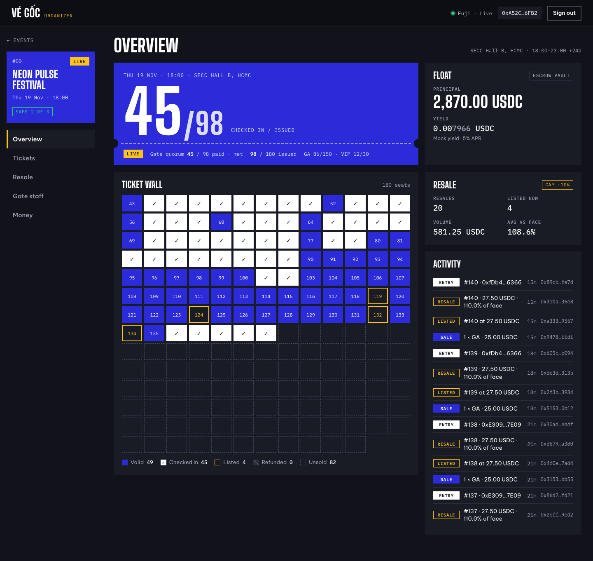

# Vé Gốc: concert tickets whose resale price is capped on chain at face value +10 %

Slides: _link to be added before submission_ ([outline](docs/SLIDES.md)) · Video (2 to 3 min): _link to be added before submission_ ([beat list](DEMO_FLOWS.md))

A ticket is an NFT that only changes hands through a built-in market, at face value +10 % at most, and the seller does not choose the buyer: the next ticket listed goes to the first wallet in a public line. Ticket money waits in an escrow vault, and the gate scans decide where it goes: a show that is cancelled, or that ends with fewer than half of its paid tickets scanned, pays every buyer back. The entry QR is signed by whoever holds the ticket at that moment, so a QR made before a resale stops working.

**Live on Avalanche Fuji, testnet only.** VeGoc [`0x6f58…3ef2`](https://testnet.snowtrace.io/address/0x6f5802cdeea534b66067607875e2e284fec93ef2) and FloatVault [`0x74fb…0a06`](https://testnet.snowtrace.io/address/0x74fb6051201c3e0cdf2d37b1753ae35d51360a06), both verified. Transactions you can open:
[gate check-in](https://testnet.snowtrace.io/tx/0x968625404cdda077fd1368f2b000304f04f0a3053a367b49e1993c35af16b32e) ·
[purchase by a wallet holding 0 AVAX, gas paid by a relayer](https://testnet.snowtrace.io/tx/0xbeffd30b731de53c4f956a13f665c5486e0b656c716e40214372f3463a550bd3) ·
[cancelled show, 5 buyers refunded in one transaction](https://testnet.snowtrace.io/tx/0xd6d327472c6ed8ad6fb69aae26f057723f137b3f8f7e786df97a1316557b9ebc) ·
[settlement executed by the second owner of a 2-of-3 Safe](https://testnet.snowtrace.io/tx/0xb96ae64736e4c5aa71a94f9ac7164160882f243d7d3e61d505ee9d9bb527c3d6) ·
[purchase with Circle's USDC](https://testnet.snowtrace.io/tx/0x419f4a848a188ca9b9931cb37159bf00cb26e8cac9acd53f2bfc23840a9d6d1c) ·
[event outcome sent over ICM](https://testnet.snowtrace.io/tx/0x38be12541409c15ca5075c1a396fdc50fdfe5fb2f757f6e546e9e70134d1ee04) and [received by Teleporter on the Dispatch L1](https://subnets-test.avax.network/dispatch/tx/0x18dfcd550d0ee50a9a1868a3062f00f1a13eeb5639dc9ec160bed6a981d80bb4).
185 tests pass ([how to run each suite](#tests)). Built from 2 to 20 Nov 2026 for Team1 Vietnam UniHack 2026, topic 9.


## The problem

Diamond VIP tickets for BIGBANG's Hanoi shows (24 and 25 Oct 2026) had a face value of 9.8 million VND ([CafeF](https://cafef.vn/chinh-thuc-cong-bo-seat-map-va-gia-ve-concert-bigbang-o-ha-noi-dat-xat-ra-mieng-cao-nhat-105-trieu-dong-188260803093946955.chn)) and resellers advertised them for 45 million, about 4.6 times ([DTiNews, 13 Aug 2026](https://dtinews.dantri.com.vn/print/20260813142023123.htm)). Ticketbox alone sold more than 1 million concert and festival tickets in Vietnam in 2025 ([VOV, 17 Dec 2025](https://kynguyenvuonminh.vov.vn/en/culture/entertainment-market-rebounds-as-concert-ticket-sales-top-1-million-post1254647.vov)). Platforms answer with resale rules and rotating barcodes, but those rules live on the platform's servers and the platform can change them.

## What we added to the topic

Topic 9 is on the organisers' list, and its required MVP is a capped market, a refund on cancel and a QR check-in. Vé Gốc goes further in four places, none of which we found in the products under [Who else does this](#who-else-does-this):

1. The seller does not pick the buyer. While anyone is in a tier's line, `list` sells to the first in line inside the same transaction and `buyListing` reverts. That closes the usual side deal ("I list it the second my customer is ready, they pay me the premium off chain").
2. The QR is the holder's signature, checked by a public contract. Any gate app can verify it against `ownerOf` at scan time, and the organizer cannot quietly change the rule.
3. The same gate signatures decide who gets the money. With at least half of the paid tickets scanned, the organizer is paid at once. Below that, it is a no-show: holders take their money back and the organizer waits 48 hours. No arbiter is needed.
4. The platform fee comes only out of money paid to an organizer. A cancelled or no-show event costs the buyer nothing and earns the platform nothing.

Also built: a relayed purchase for a wallet with no AVAX (`buyFor`), events organized by a 2-of-3 Safe, a second deployment on Circle's USDC, and an ICM message that tells another Avalanche L1 how each finished event ended.

## Live on Fuji (chain 43113)

| Contract | Address | Verified |
|---|---|---|
| VeGoc (events, tickets, market, waitlist, gate, refunds) | [`0x6f5802cdeea534b66067607875e2e284fec93ef2`](https://testnet.snowtrace.io/address/0x6f5802cdeea534b66067607875e2e284fec93ef2) | yes (Routescan / Snowtrace) |
| FloatVault (escrow, mock yield from each event's funded reserve) | [`0x74fb6051201c3e0cdf2d37b1753ae35d51360a06`](https://testnet.snowtrace.io/address/0x74fb6051201c3e0cdf2d37b1753ae35d51360a06) | yes |
| MockUSDC (test token, 6 decimals, faucet) | [`0x0c13cf96d2b8ebaafc32e8ab4449962d4adc28eb`](https://testnet.snowtrace.io/address/0x0c13cf96d2b8ebaafc32e8ab4449962d4adc28eb) | yes |
| AttendanceRelay (sends a finished event's outcome over ICM) | [`0xeC2766b92F1236c435a82550a888a3D23d3E51d5`](https://testnet.snowtrace.io/address/0xeC2766b92F1236c435a82550a888a3D23d3E51d5) | yes |
| Safe v1.4.1, 2 of 3 owners (organizer of events 0, 2, 5; receives the 3 % platform fee) | [`0x96aDD8A7c64d93818cc71eb6E97Db478a091bc41`](https://testnet.snowtrace.io/address/0x96aDD8A7c64d93818cc71eb6E97Db478a091bc41) | canonical Safe proxy ([created here](https://testnet.snowtrace.io/tx/0x68040446ded82594b72d3f65f80db922c88e0bfbded87c7c517da193359fe3e5)) |

The same code runs a second time against Circle's test USDC [`0x5425…Bc65`](https://testnet.snowtrace.io/address/0x5425890298aed601595a70AB815c96711a31Bc65): VeGoc [`0xe5c2…ebeb`](https://testnet.snowtrace.io/address/0xe5c2aa021be8bc725b35a6e9cd30ab8e43c6ebeb), FloatVault [`0x4261…e7f4`](https://testnet.snowtrace.io/address/0x426174f593a19db398131b84d62a3b9eef23f7e4), both verified. One event ran there from sale to settlement and one is on sale until 6 Dec.

| # | Event | Organizer | State on 19 Nov 2026 |
|---|---|---|---|
| 0 | Neon Pulse Festival, 12 to 13 Dec, GA 25 / VIP 60 USDC, max 4 per wallet | Safe | on sale: 101 issued, 22 resales, 54 scanned in advance, 3 VIP listed, one purchase relayed for a wallet holding no AVAX |
| 1 | Saigon Indie Night, 5 Dec | organizer wallet | on sale, 12 sold; one ticket resold to the first wallet in line |
| 2 | Rooftop Session | Safe | ended with the gate quorum met (9 of 16 scanned), not settled yet |
| 3 | Hanoi Lantern Night, 30 Nov | organizer wallet | cancelled, all 5 tickets refunded in one transaction |
| 4 | Soundcheck Session | organizer wallet | ended with nobody scanned: no-show, refunds open, settlement locked until 21 Nov 04:02 (+07) |
| 5 | Warm-up Set | Safe | ended with 4 of 6 scanned, settled by two Safe owners |

The counts are read from chain and stored under `atCapture` in [`docs/fuji-run.json`](docs/fuji-run.json). Of the 101 tickets, 22 resales and 54 check-ins on event 0, 94 tickets, 15 resales and 50 check-ins are sample activity: real transactions from 40 script wallets made by [`scripts/fuji-seed.mjs`](scripts/fuji-seed.mjs). Every other hash, and the full list of what ran, is in [`docs/FUJI.md`](docs/FUJI.md).

Checks anyone can run (`B=0x6f5802cdeea534b66067607875e2e284fec93ef2`, `R=https://avalanche-fuji-c-chain-rpc.publicnode.com`, `H=0x1686208853AfDEDAE5133E12BcB7c4a87215a8D5` holds ticket 142, a GA ticket):

| Rule | Command | Answer |
|---|---|---|
| No transfer outside the market | `cast call $B 'transferFrom(address,address,uint256)' $H 0x9638F49A3cB7c002779724b427905F6Ab1D54BFA 142 --from $H --rpc-url $R` | reverts `0xf90e674a` = `TransferBlocked()` |
| Resale cap | `cast call $B 'list(uint256,uint256)' 142 27500001 --from $H --rpc-url $R` | reverts `AboveCap(27500000)` |
| QR valid 5 minutes at most | `cast call $B 'checkIn(uint256,uint256,bytes)' 142 1900000000 0x00 --from 0x058b326D8A3B7f69FAC9cFB0a772a63e4d26FAA1 --rpc-url $R` | reverts `0x48f0fae6` = `DeadlineTooFar()` |
| Escrow is whole | `cast call 0x74fb6051201c3e0cdf2d37b1753ae35d51360a06 'totalPrincipal()(uint256)' --rpc-url $R` plus `reserve()` | equals the vault's USDC balance |
| ICM message arrived on Dispatch | `cast call 0x253b2784c75e510dD0fF1da844684a1aC0aa5fcf 'messageReceived(bytes32)(bool)' 0xf6ce233f7c0848cb3c2a1a4aa5c3b3190d986e265737a29e1e2353420c556c94 --rpc-url https://subnets.avax.network/dispatch/testnet/rpc` | `true` |

## Why on-chain, why Avalanche, where the money comes from

**Why on-chain.** The cap, the order of the line, the ban on off-market transfers, the escrow and the refund rules are code that neither the organizer nor the platform can change after a sale. A buyer can read on Snowtrace that the money is still in the vault. A rule at Ticketmaster or Ticketbox holds only inside that platform, and the platform can change it.

**Why Avalanche.**

- A gate needs an answer while the guest is standing there. On Fuji a check-in landed in a block 0.3 s after it was sent and the receipt was in hand after 2.5 s ([measured](#measured-on-fuji)).
- At the C-Chain mainnet base fee a Circle-USDC purchase costs 0.0019 AVAX and a check-in 0.0004 AVAX.
- Circle issues USDC natively on the C-Chain and on Fuji, and the second deployment runs on it. The canonical Safe contracts are deployed there too.
- Another Avalanche L1 can learn how a show ended without an oracle: `AttendanceRelay` reads the outcome from VeGoc and sends it over ICM (Teleporter); details in [ICM](#icm-telling-another-l1-how-an-event-ended). The console's activity feed also gets its first paint from the Avalanche Data API.

**Where the money comes from.** Buyers pay face value in USDC into FloatVault. After a show that happened, 97 % goes to the organizer and 3 % to the platform (`feeBps = 300`, fixed at deployment). Resale money goes from buyer to seller; resale carries no fee today. Worked out for a 10,000-seat show in [Business model](#business-model).

**Where the yield comes from.** It is mocked: FloatVault accrues a fixed 5 % a year on each event's principal and pays it from that event's own reserve, which the organizer funded beforehand with test USDC. Nothing is minted. In production the vault would wrap USDC supplied to Aave v3 on the C-Chain, where the yield is interest paid by borrowers. That vault is not built, and no token of our own exists or is planned.

## Vietnam law

- USDC cannot be the payment in Vietnam. Decree 52/2024/NĐ-CP on cashless payments (in force 1 Jul 2024) lists the lawful cashless payment instruments in Art. 3(10); anything else is an "illegal payment instrument" (Art. 3(11)), and issuing, supplying or using one is prohibited (Art. 8(6)). E-money must be Vietnamese dong (Art. 3(12)). Text: [LuatVietnam](https://luatvietnam.vn/tai-chinh/nghi-dinh-52-2024-nd-cp-cua-chinh-phu-quy-dinh-ve-thanh-toan-khong-dung-tien-mat-336447-d1.html). The State Bank's position that crypto assets are not a lawful means of payment is reported by [Báo Hà Tĩnh, 8 Mar 2025](https://baohatinh.vn/dong-tien-pi-co-duoc-su-dung-vao-hoat-dong-thanh-toan-khong-post283898.html).
- We cannot collect VND ourselves without a licence either. Wallets, payment gateways and collection services by a non-bank need a State Bank licence (Art. 22(2)); providing them without one is prohibited (Art. 8(7)). So in Vietnam the ticket would be paid in VND through a licensed payment intermediary.
- Crypto assets are legal property, but the pilot market trades them only in VND. Law 71/2025/QH15 on the digital technology industry, in force since 1 Jan 2026, recognises digital assets (Art. 47, [text](https://english.luatvietnam.vn/lawonthedigitaltechnologyindustryno71-2025-qh15datedjune142025ofthenationalassembly-405695-doc1.html)). Resolution 05/2025/NQ-CP pilots a crypto-asset market where offering, trading and payment are in VND through providers licensed by the Ministry of Finance (Art. 4(7), Art. 7, [text](https://xaydungchinhsach.chinhphu.vn/toan-van-nghi-quyet-so-5-2025-nq-cp-ve-trien-khai-thi-diem-thi-truong-tai-san-ma-hoa-tai-viet-nam-119250909184045221.htm)).

What this means for the product: in Vietnam today the USDC escrow is off, and with it the automatic refunds, the no-show rule and the on-chain fee. Refunds are paid in VND by the intermediary and the 3 % is invoiced to the organizer in VND. What stays on chain is the ticket ledger: the cap, the line, the transfer block and the gate QR. The VND payment leg is not built. The escrow and yield apply only where paying for a ticket in a stablecoin is legal. We found no Vietnamese guidance on NFT tickets, and we have had no legal review. No personal data is stored on chain, and this demo takes no real money.

## ICM: telling another L1 how an event ended

The venue-L1 design in [ARCHITECTURE.md](docs/ARCHITECTURE.md#an-avalanche-l1-for-venues-designed-not-deployed) needs the C-Chain and the L1 to agree on whether a show happened. The sending half of that runs on Fuji today.

- [`AttendanceRelay`](src/icm/AttendanceRelay.sol) on Fuji reads an event from VeGoc and, once the outcome is final (cancelled, or past its end), sends `(eventId, organizer, outcome, paidSold, paidCheckedIn)` through Teleporter to the Dispatch test L1. Anyone may call it; the caller cannot choose what is sent, and each event goes once.
- [`AttendanceMirror`](src/icm/AttendanceMirror.sol) is the receiver. It accepts a message only from Teleporter, from the Fuji C-Chain and from that relay, and stores the outcome so a contract on the L1 could, for example, return a venue deposit or issue a fan badge only for shows that happened.
- Events 2 to 5 were relayed on 20 Nov 2026 with [`scripts/fuji-icm.sh`](scripts/fuji-icm.sh). The public relayer delivered each message to Dispatch about 7 s after it was sent:

| Event | Outcome sent | Sent on Fuji | Received on Dispatch |
|---|---|---|---|
| 2 | happened, 9 of 16 scanned | [0xcbf0…8cac](https://testnet.snowtrace.io/tx/0xcbf0c4315a97e53b4f9f59fa1a62ba4a551fd8a033f8bb2a3e3785f802b08cac) | [0x3061…7410](https://subnets-test.avax.network/dispatch/tx/0x3061120e83f4b59eed845107430cfa93cfc9fffc3cfbfc2b488634e78e317410) |
| 3 | cancelled | [0x5a29…c1bb](https://testnet.snowtrace.io/tx/0x5a29c14598b8356853809872439a33b542213572231c4b5d02c493e6e9bac1bb) | [0x4644…5d12](https://subnets-test.avax.network/dispatch/tx/0x4644019e50fbdb12fec67ef5bbafae8ec6b06c3ee9d8add560aa88c55c475d12) |
| 4 | no-show, 0 of 4 scanned | [0x3d87…ca39](https://testnet.snowtrace.io/tx/0x3d87737024d1c5074efe1bd3030eeb0888ec061341a20f0f9948286fe7d8ca39) | [0x4a5c…803d](https://subnets-test.avax.network/dispatch/tx/0x4a5c4ed729c7bd56199cddff995b6c24be21e59f65ae94ba10ccb36c2043803d) |
| 5 | happened, 4 of 6 scanned | [0x38be…ee04](https://testnet.snowtrace.io/tx/0x38be12541409c15ca5075c1a396fdc50fdfe5fb2f757f6e546e9e70134d1ee04) | [0x18df…0bb4](https://subnets-test.avax.network/dispatch/tx/0x18dfcd550d0ee50a9a1868a3062f00f1a13eeb5639dc9ec160bed6a981d80bb4) |

**What is not done:** `AttendanceMirror` is not deployed on Dispatch, because our wallets hold no DIS and the faucet needs a signed-in account. Teleporter on Dispatch therefore received each message and stored it as not executed (`MessageExecutionFailed`), so nothing on Dispatch holds the outcomes yet. The relay already points at the mirror's future address, `0x36AB…14aA` (the deployer's first contract on Dispatch). [`scripts/fuji-icm-dryrun.sh`](scripts/fuji-icm-dryrun.sh) shows the rest without gas: on a fork of Dispatch it checks that the hash Teleporter stored equals the message sent on Fuji, places the mirror's code at that address, retries the stored message and reads back the record (event 5: outcome 1, 6 sold, 4 scanned). Records: [`docs/fuji-icm.json`](docs/fuji-icm.json).

## Measured on Fuji

Three rounds on 19 Nov 2026 (+07) with [`scripts/measure.mjs`](scripts/measure.mjs); medians, raw rows in [`docs/fuji-measure.json`](docs/fuji-measure.json). The clock starts when the signed transaction is sent. "In a block" uses the block's own millisecond timestamp (`timestampMilliseconds`); "receipt" is when a public RPC polled every 100 ms returned it.

| Action | Tx | Gas | In a block after | Receipt after | Fee at the mainnet base fee* |
|---|---|---|---|---|---|
| Buy 1 GA ticket, permit and purchase in one transaction | [0xe2d6…9831](https://testnet.snowtrace.io/tx/0xe2d6552ce87a44c8163417ff683a93d9e8151fd0628c147c5e8c7dc75ac69831) | 216,655 | 0.8 s | 3.2 s | 0.0016 AVAX |
| List at the cap, sold to the first in line in the same transaction | [0x344d…2ed5](https://testnet.snowtrace.io/tx/0x344dc70a6c7cd13c8d0c9572e1c75a066145b6d853687caf80e1827b9ca22ed5) | 207,029 | 0.6 s | 2.7 s | 0.0016 AVAX |
| Join the GA line, deposit = the cap | [0x3107…7efe](https://testnet.snowtrace.io/tx/0x3107a9201d883d6781473ac997274cab0e37bd7f5bebd050ed6f259a5b7f7efe) | 228,720 | 0.3 s | 2.4 s | 0.0017 AVAX |
| Gate check-in | [0x22af…2a33](https://testnet.snowtrace.io/tx/0x22afaa2761f59104d04e3b3f212e6825e14637da32b6b154e59840716e952a33) | 55,870 | 0.3 s | 2.5 s | 0.0004 AVAX |
| Buy 1 ticket with Circle's USDC (second deployment) | [0x419f…6d1c](https://testnet.snowtrace.io/tx/0x419f4a848a188ca9b9931cb37159bf00cb26e8cac9acd53f2bfc23840a9d6d1c) | 255,310 | | | 0.0019 AVAX |
| Relayed purchase, the buyer holds no AVAX (`buyFor`) | [0xbeff…0bd3](https://testnet.snowtrace.io/tx/0xbeffd30b731de53c4f956a13f665c5486e0b656c716e40214372f3463a550bd3) | 282,590 | | | 0.0021 AVAX |
| Send an event's outcome over ICM | [0x3d87…ca39](https://testnet.snowtrace.io/tx/0x3d87737024d1c5074efe1bd3030eeb0888ec061341a20f0f9948286fe7d8ca39) | 228,843 | | about 7 s until Teleporter on Dispatch had it | 0.0017 AVAX |

\* gas × 7.509 nAVAX, the base fee `cast base-fee --rpc-url https://api.avax.network/ext/bc/C/rpc` returned when the script ran. Fuji transactions paid 160 wei per gas (10 wei base fee plus a 150 wei tip), so Fuji fees say nothing about real cost. More rows (resale without a line, the first purchase on a cold deployment) are in [`docs/FUJI.md`](docs/FUJI.md).

## What it does


| | Guest (mobile app, `app/`) | Organizer (web console, `admin/`) |
|---|---|---|
| Event | browse events, tiers, seats left | create an event with up to 4 tiers and a per-wallet limit |
| Buy | pay USDC in one transaction through an EIP-2612 permit | issue free tickets (entry only, never resellable) |
| Resale | list at any price up to face +10 %; join a tier's line (deposit = the cap) and get the next ticket listed; leave the line and take the deposit back | listings, people in line, resale count, volume, average price against face |
| Gate | holder shows a signed QR, valid 3 minutes in the app (the contract allows 5 at most); gate staff check in on chain | grant or revoke gate wallets; quorum counter; extend a running event by up to 24 h |
| Money | refund button after a cancel or a no-show | float and mock yield live; cancel and refund every holder; settle after the show, minus the 3 % fee |
| Safe | | an event organized by a Safe needs two owners per organizer action: the first approves, the second executes |




All images were captured on Fuji on 19 Nov 2026.

## How it works

- Tickets are ERC-721. `_update` lets a held ticket move only inside the market, so `transferFrom` between holders reverts. A checked-in ticket never moves again.
- `list` reverts above `face × 11000 / 10000`. While anyone is in the tier's line, `list` sells the ticket to the first in line, paid from that wallet's deposit, and `buyListing` reverts `WaitlistFirst`. Joining the line needs the full cap as a deposit and is closed while a listing is open.
- `buyFor` takes the buyer's EIP-712 `Buy(buyer, eventId, tier, quantity, nonce, deadline)` signature and USDC permit, so anyone can send the purchase and pay its gas. The ticket and the payment are the buyer's.
- Tickets can only be held by addresses without code, and `checkIn` accepts an ECDSA signature from that address only (no ERC-1271). A contract holding a ticket could be sold without the ticket moving; here it cannot receive one.
- The QR carries the EIP-712 message `CheckIn(uint256 tokenId,uint256 deadline)` under the domain `{name: "VeGoc", version: "1", chainId, verifyingContract}`. `checkIn` compares the signer with `ownerOf` at that moment, refuses a deadline more than 5 minutes ahead, and closes when the event ends.
- Primary-sale USDC goes to FloatVault under the event id. At or above the half quorum the organizer can `settle` at once: 3 % to the platform's `feeRecipient`, the rest plus the event's mock yield to the organizer. Below it, holders of unscanned tickets take face value back (`claimRefund`, or anyone calls `refundMany`) and `settle` stays locked for 48 hours. If the gate was down, the organizer can `extendEvent` by up to 24 hours before the end.
- After `cancelEvent` every holder can be refunded and the organizer only takes the yield accrued up to the cancel.
- Neither contract has an owner, a pause or an upgrade key.

Diagrams, state machines, the role matrix and the threat model, including what the round-1 and round-2 security reviews found: [docs/ARCHITECTURE.md](docs/ARCHITECTURE.md).

## Who else does this

| Product | What it does | Where the rule lives |
|---|---|---|
| Ticketmaster SafeTix | rotating barcode "tied directly to a verified fan account"; transfers only inside Ticketmaster ([Ticketmaster](https://business.ticketmaster.com/safetix/), [404 Media on the DOJ complaint, 21 Aug 2024](https://www.404media.co/ticketmaster-used-revolving-barcodes-to-control-ticket-resale-market-and-surveil-customers-doj-alleges/)) | the company's servers and app |
| Ticketbox resale (Vietnam) | official resale channel since Dec 2025; the buyer gets a new QR; no price cap or fee is published ([Ticketbox, 11 Dec 2025](https://www.threads.com/@ticketbox.vn/post/DSJrerOjsaZ/), [3 Mar 2026](https://www.threads.com/@ticketbox.vn/post/DVazeryj0jq/)) | the platform |
| CTicket REAL FAN (Vietnam) | artist quiz in place of a CAPTCHA and an IP filter at purchase, used for the BIGBANG sale ([VietNamNet, 21 Aug 2026](https://vietnamnet.vn/en/bigbang-hanoi-ticket-rush-puts-cticket-technology-to-the-test-2547749.html)) | the platform; it acts at purchase, resale happened anyway |
| OPEN, formerly GET Protocol | NFT tickets for ticketing companies, each sale, resale and scan recorded on Polygon ([docs, 10 Jun 2025](https://docs.onopen.xyz/docs/token-economics-overview)) | the docs do not say who enforces resale rules |
| Dreamus / SK Planet on an Avalanche subnet | NFT tickets in OK Cashbag; a maximum resale price can be set per collection ([Avalanche, 21 Sep 2023](https://www.avalanche.com/blog/korean-entertainment-giant-powers-ticketing-platform-with-avalanche), [Decrypt](https://decrypt.co/198091/south-koreas-dreamus-puts-nft-tickets-avalanche-events-kpop-concerts)) | the collection contract, on their own chain |
| UK law | resale above face value is to become illegal; not law yet on 24 Aug 2026 ([gov.uk, 19 Nov 2025](https://www.gov.uk/government/news/government-bans-ticket-touting-to-protect-fans-from-rip-off-prices), [Full Fact](https://fullfact.org/government-tracker/ticket-resales-consumer-protections/)) | legislation |

Capped NFT resale exists already, on Avalanche too. What is new here is listed in [What we added to the topic](#what-we-added-to-the-topic). In Vietnam today points 3 and 4 of that list are off, because they need the USDC escrow; the cap, the line, the transfer block and the QR stay.

## Business model

The platform takes 3 % of each settled event's primary sales, paid by `settle` to the Safe. In Vietnam, where the escrow is off, the same 3 % is invoiced to the organizer in VND. For a 10,000-seat show at an average of 2,000,000 VND per ticket (our assumption; BIGBANG's Hanoi tiers ran from 1 to 10.5 million VND):

| Item | Amount |
|---|---|
| Ticket sales | 20 billion VND (about 779,700 USDC at the State Bank's central rate of 25,652 VND on 17 Nov 2026, [VietnamBiz](https://vietnambiz.vn/ty-gia-trung-tam-len-cao-ky-luc-cac-chuyen-gia-du-bao-phai-sang-nam-2027-moi-ha-nhiet-20261118121443876.htm)) |
| Platform fee, 3 % | 600 million VND |
| Gas for 10,000 purchases and 10,000 check-ins | 23.4 AVAX at the mainnet base fee measured above (255,310 + 55,870 gas, × 10,000 × 7.509 nAVAX); relaying purchases through `buyFor` adds about 66,000 gas each; paid by the platform out of the fee |
| Float yield for the organizer, where the escrow is legal | 112 to 204 million VND for 60 days at 3.4 to 6.2 % a year, the range of Aave v3's USDC supply rate on Avalanche over 12 to 18 Nov 2026 ([Aavescan](https://aavescan.com/avalanche-v3/usdc)) |

At the same assumed average, 3 % of Ticketbox's 1 million tickets is about 60 billion VND a year. For comparison, Eventbrite lists 3.7 % plus 1.79 USD per ticket and 2.9 % payment processing in the US ([pricing page](https://www.eventbrite.com/organizer/pricing/)). No organizer or venue has seen Vé Gốc yet.

## Custody, wallets and mocks

- Custody. Ticket money is pooled in FloatVault, which topic 9 allows. The vault obeys only VeGoc, and VeGoc pays it to ticket holders (cancel, no-show) or, after a show that met the quorum or after the 48-hour hold, to the organizer and the platform. Showcase events 0, 2 and 5 are organized by a 2-of-3 Safe that also receives the fee; event 5 was settled by two owners. **On testnet the three Safe owners are team keys on one laptop**, so the Safe shows the two-signer flow, not independent custody. The contract cannot tell a multisig from another contract, so "organizers must be Safes" is an app listing policy.
- Wallets and gas. Guests hold tickets in their own wallet. This demo build embeds three throwaway test keys (Guest A, Guest B, Gate staff) with a wallet switcher, on chains 31337 and 43113 only. `buyFor` ran once on Fuji for a wallet holding no AVAX, with the gate wallet standing in for the platform's relayer. Relayed listing, waitlist and check-in, a hosted relayer and an embedded wallet with phone sign-in are not built.
- Mocks and dev toggles. (1) MockUSDC with a public faucet on the main deployment; the second deployment uses Circle's USDC. (2) Mock yield at 5 % a year from each event's pre-funded reserve. (3) Three embedded test keys. (4) On the web build the gate pastes the QR payload; the native app scans with the camera. (5) Events 2, 4 and 5 were created to end minutes after seeding, so settlement and the no-show can be shown. (6) The audience on events 0 to 5 is sample activity from 40 script wallets; event 0 was scanned before its start date for the same reason. (7) Tickets on the Circle USDC deployment cost 0.05 USDC, because the test USDC came from a small Pangolin pool.

## Limits

- Not audited. Testnet only.
- The cap binds the on-chain price. When nobody is in line, a listing is open to the first taker, so a scalper's named customer can still win the race and pay the premium off chain. Selling a whole wallet's private key also stays possible. Purchase-time anti-bot checks are not built.
- An organizer who buys half of the paid tickets through their own wallets and scans them can fake the quorum for a show that never happened, at the cost of the 3 % fee on those tickets. A dispute process would be needed on top.
- If the gate fails at a real show and the organizer does not `extendEvent` in time, every unscanned holder can take a refund.
- `checkIn` closes at the end but does not wait for the start; the showcase was scanned before its start date. A production contract should open the gate a few hours before `startsAt`.
- Gate staff are trusted: a staff wallet holding a fresh QR could check that ticket in without the guest.
- Smart-contract wallets cannot hold tickets.
- The ICM receiver is not deployed on Dispatch, and the venue L1 is a design, not a chain we run.
- `ticketsOf`, `listings`, `getEvents` and `waitlistPlace` are linear view functions; large events need an indexer.
- Anyone can create an event on the contract. The app lists only configured organizers.
- Roadmap: VND payment partner, embedded wallet and hosted relayer, Aave v3 vault where the escrow is legal, resale royalty for the artist, a gate that opens before the start, the mirror on an L1 that consumes it.

## Run locally

Needs Foundry, Node 22 or newer, and Chrome (for the end-to-end tests).

```sh
git clone --recurse-submodules https://github.com/buiPhongGiang/ticketing.git && cd ticketing
forge build && forge test

# Terminal 1: anvil + contracts + 3 demo events, writes app/.env.dev and admin/.env.dev
./scripts/dev-chain.sh
# Terminal 2: sample purchases
./scripts/demo-seed.sh

# Terminal 3: guest app (Expo web) on http://localhost:8081
cd app && npm ci && npm run web

# Terminal 4: organizer console on http://localhost:8093
cd admin && npm ci && npx vite --mode dev --port 8093
```

The app switches between Guest A, Guest B and Gate staff from the address chip (top right). The console needs a browser wallet on the local chain (RPC `http://127.0.0.1:8545`, chain 31337) with anvil's public test key #0, which is the organizer. Never use that key on a real network.

Against Fuji: `cd app && ENV_FILE=.env.fuji npm run web` and `cd admin && npx vite --mode fuji --port 8093`. The env files come from the deployment steps, which need a gitignored `.env.fuji` with `FUJI_RPC`, `TICKET_ORGANIZER_*`, `GUEST_A_*`, `GUEST_B_*`, `GATE_*`, `SAFE_OWNER_2_*`, `SAFE_OWNER_3_*` (`_ADDRESS` and `_KEY`), `SAFE_ADDRESS` and `SEED_MNEMONIC`, holding test AVAX from the [faucet](https://build.avax.network/console/primary-network/faucet):

```sh
node scripts/fuji-safe.mjs      # 2-of-3 Safe from the canonical contracts on Fuji (once)
./scripts/fuji-deploy.sh        # deploy, verify, write env files; USDC_ADDRESS=<token> ENV_SUFFIX=-usdc uses an existing token
node scripts/fuji-seed.mjs      # six events and about 300 transactions of sample activity (16 minutes)
node scripts/fuji-usdc.mjs      # the Circle USDC run on the second deployment (12 minutes)
node scripts/measure.mjs        # the measurement table
./scripts/fuji-icm.sh           # AttendanceRelay, relay finished events to Dispatch over ICM
./scripts/fuji-icm-dryrun.sh    # read-only: retry the stored ICM messages on a Dispatch fork with the mirror in place
node scripts/pre-record.mjs     # read-only check before a recording or a live demo
```

## Tests

185 tests, all passing on 20 Nov 2026 (exit code 0 for each command):

| Suite | Command | Passed | What it covers |
|---|---|---|---|
| Contracts | `forge test` | 74 (3 fuzz; the 2 fork suites skip without an RPC) | every money path: USDC into the vault, wallet limit, permit purchase, relayed purchase, transfer block, cap (fuzzed), resale payment, price-change guard, waitlist (order, deposit, leave, credit, contracts refused, fuzzed solvency), check-in by the current holder only, replay, 5-minute QR ceiling, gate extension, cancel and refunds, no-show refunds and the 48-hour lock, half quorum, settle with the fee, yield from each event's own reserve, vault solvency (fuzzed), the review attacks of rounds 1 and 2 with their residuals, ICM relay and mirror (final outcomes only, once per event, forged senders refused) |
| Contracts on a Fuji fork | `FUJI_RPC_URL=https://avalanche-fuji-c-chain-rpc.publicnode.com forge test --match-path 'test/*Fork*'` | 4 | Circle's real USDC: permit purchase, capped resale, check-in, settlement, cancel and refund; a real Safe v1.4.1 as organizer, one owner alone refused |
| App chain layer | `cd app && npm test` | 57 | against a real anvil: permit checkout, cap refused before signing, resale pays the seller, waitlist, old QR refused, single entry, refunds, race for the last ticket, journal recovery |
| App end to end | `cd app && npm run e2e` | 4 | Chrome at 390×844 on Expo web against anvil: buy, resell, waitlist, old QR refused, entry, replay refused; cancel and refund |
| Console logic | `cd admin && npm test` | 33 (plus 1 against live Fuji with `FUJI_RPC_URL`) | event status and quorum, ticket wall, CSV, resale stats, settle states, Data API shortcut, Safe verification (a fake Safe is refused), Safe signatures |
| Console end to end | `cd admin && npm run e2e` | 13 | Chrome with an injected test wallet on anvil: create event, free tickets, gate staff, cancel and refund all, settle with the fee, no-show lock and refunds |

`app` and `admin` typecheck (`npm run typecheck`) and the console builds (`npm run build`). The unit suites start anvil on a port the system assigns, so two runs do not collide.

## Repository map

| Path | What is there |
|---|---|
| `src/VeGoc.sol` | events, ERC-721 tickets, market, waitlist, relayed purchase, gate, refunds, settlement |
| `src/FloatVault.sol`, `src/MockUSDC.sol` | per-event escrow with mock yield from per-event reserves; test token |
| `src/icm/` | `AttendanceRelay` (Fuji, deployed), `AttendanceMirror` (receiver, not deployed), the Teleporter interface |
| `test/` | Foundry tests, review regressions (`Regression.t.sol`), ICM (`AttendanceRelay.t.sol`), fork tests |
| `script/`, `scripts/` | deployment, ICM dry run; Fuji Safe, seed, Circle USDC run, measurement, ICM relay, pre-record check; local chain |
| `app/` | guest and gate app (Expo, React Native); `src/lib` is the chain layer with the transaction journal |
| `admin/` | organizer console (Vite, React); `src/safe.ts` Safe verification, `src/logs.ts` activity index |
| `docs/` | architecture and threat model, Fuji transactions (`FUJI.md`), slide outline, images, deployment, ICM and run records |
| `DEMO_FLOWS.md` | the demo beats with captions and the pre-record checklist |

## Team and license

buiPhongGiang. All code was written during the hackathon; the first commit is from 2 Nov 2026. MIT license, see [LICENSE](LICENSE).
