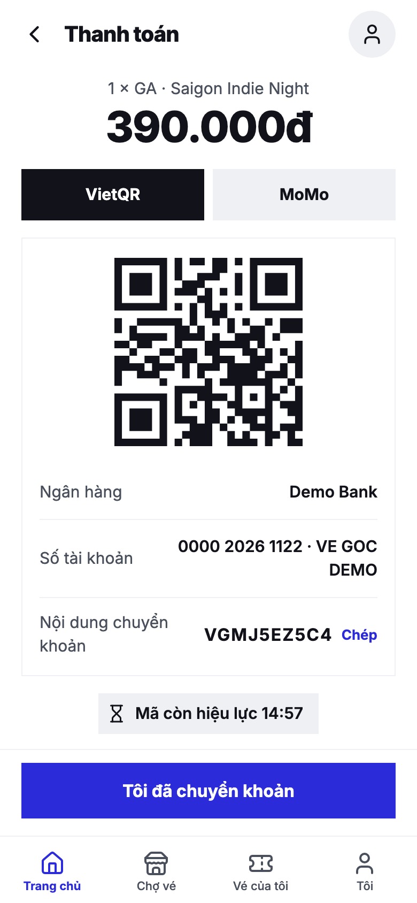
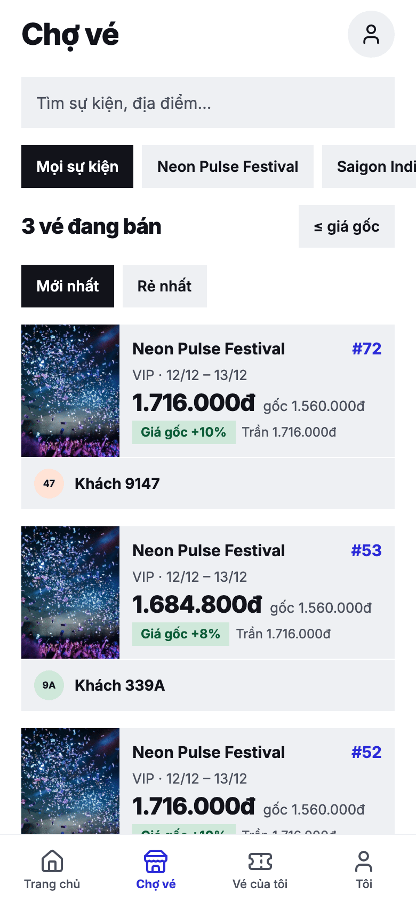
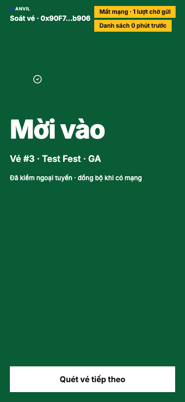
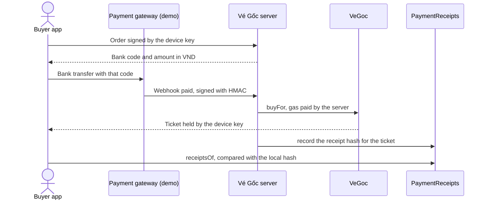
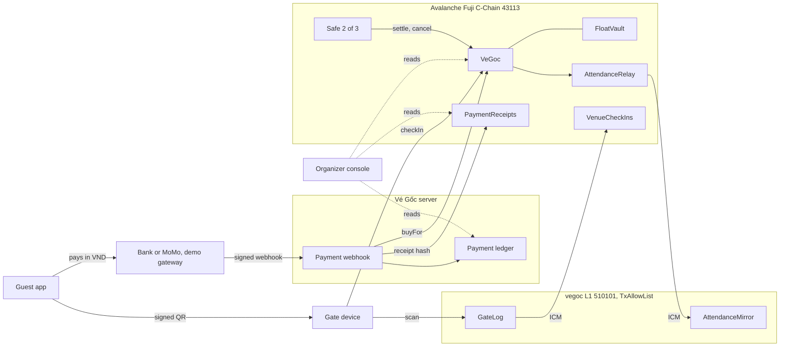
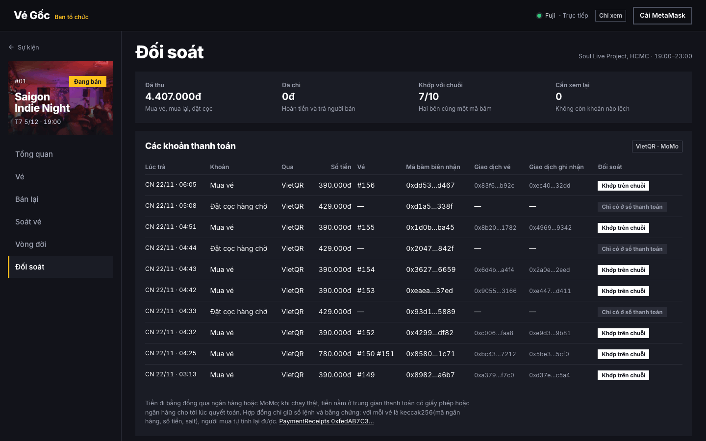

<p align="center"></p>

<h1 align="center">Vé Gốc</h1>

<p align="center">
Concert tickets paid in Vietnamese đồng by bank transfer, resold at no more than face value +10% to the first person in an on-chain line.
</p>

<table>
<tr>
<td width="33%"></td>
<td width="33%"></td>
<td width="33%"></td>
</tr>
<tr>
<td align="center">Pay by VietQR transfer</td>
<td align="center">Chợ vé, the capped resale market</td>
<td align="center">Door check with the network down (local test chain)</td>
</tr>
</table>

| | |
|---|---|
| Pay | VND bank transfer or MoMo. The guest sees no wallet, coin or gas fee. |
| Resale | Capped by the contract at face value +10%. The ticket goes to the first person in line. |
| Proof | A hash of each payment is stored on Avalanche per ticket, and the app checks the receipt against it. |

The contracts run on the Avalanche Fuji testnet. The links below document the Demo Day build. Use [Run it](#run-it) to start the current version on a local chain.

[View the pitch on Canva](https://www.canva.com/design/DAHbZKj3Cxk/ZEUgbgWTKDwjKFzu3gMBbw/view) · [Watch the Fuji demo](https://ve-goc-unihack-2026.bpg-infosec.chatgpt.site/ve-goc-fuji-demo-long-giong.mp4) · [Open the 3D pitch](https://ve-goc-unihack-2026.bpg-infosec.chatgpt.site) · [Speaker notes](https://ve-goc-unihack-2026.bpg-infosec.chatgpt.site/loi-pitch.txt)

## What it does

- **Payment in VND.** The guest pays by VietQR bank transfer or MoMo through a demo gateway. The server then buys the ticket on chain for a key stored on the guest's phone and pays the gas.
- **Capped resale with a line.** `list` reverts above face value +10%. While anyone waits in a tier's line, a new listing is sold to the first in line inside the same transaction, so the seller cannot choose the buyer. Tickets cannot be transferred outside this market.
- **Receipt on Avalanche.** For every payment the server records `keccak256(bankCode, amountVnd, salt)` for the ticket in `PaymentReceipts`. The app recomputes the hash on the phone and compares it with the chain.
- **Door check-in, also offline.** The QR is the holder's EIP-712 signature and is valid for 3 minutes. The gate verifies it on chain, or offline against a cached holder list, and sends the queued scans when the network returns.
- **Organizer console.** Sales per tier, gate staff, cancel and refund, settlement through a 2-of-3 Safe, and Đối soát (reconciliation): each VND payment listed next to its hash on chain.

## How it works

### A purchase in VND



1. **Order.** The app signs the order (EIP-712 `Buy`) with the device key. The server reads the price from `VeGoc` and answers with a bank code and an amount in đồng.
2. **Transfer.** The guest pays that amount with the code as the transfer note.
3. **Webhook.** The gateway reports the payment to `POST /webhook/payment`. The server checks the HMAC-SHA256 of the raw body, the amount, the expiry, and that the code has not been used.
4. **Ticket.** The server sends `buyFor`. The ERC-721 ticket belongs to the guest's device key.
5. **Receipt.** The server records the payment hash in `PaymentReceipts`. The salt is random per payment and is given only to the buyer, who can check the receipt in the app at any time.

Resale purchases and waitlist deposits are paid the same way. A refund is ordered on chain by the holder (`claimRefund`), and the VND payout is recorded with the same hash scheme.

### Architecture



| Where | What runs there |
|---|---|
| C-Chain (43113) | `VeGoc`: events, ERC-721 tickets, the capped market and the line, check-in, refunds, settlement. `FloatVault`: escrow per event. `PaymentReceipts`: one hash per payment. A 2-of-3 Safe organizes events 0, 2 and 5. |
| L1 `vegoc` (510101) | The venue's door log. `GateLog` stores scans and `AttendanceMirror` stores how each event ended. The TxAllowList precompile lets only allowed wallets send transactions, and gas is paid in the venue's token VGC. |
| ICM (Teleporter) | Carries door scans from the L1 to `VenueCheckIns` on the C-Chain and event outcomes from `AttendanceRelay` back to the L1. |
| Off chain | The VND transfer, the payment ledger, likes, comments and seller notes. |

`VeGoc`, `FloatVault` and `PaymentReceipts` have no owner, no pause and no upgrade key. State machines, the role matrix and the threat model are in [docs/ARCHITECTURE.md](docs/ARCHITECTURE.md).



The Đối soát tab on Fuji. The three unmatched rows are waitlist deposits, which have no ticket yet to record a hash against.

## Proof on Fuji

All transactions are on the Fuji testnet. The complete list is in [docs/FUJI.md](docs/FUJI.md) and the VND runs are in [docs/fuji-vnd.json](docs/fuji-vnd.json).

| What | Where | Link |
|---|---|---|
| **Payment** | | |
| First ticket paid in VND (ticket 149), bought by the server for a guest holding no coin | [`VeGoc`](https://testnet.snowtrace.io/address/0x6f5802cdeea534b66067607875e2e284fec93ef2) `buyFor` | [0xa379…f7c0](https://testnet.snowtrace.io/tx/0xa3794cd05265bb3a269c389a13138da4d639d85ca9b97a7b41659bc3c49ef7c0) |
| Hash of that payment recorded for ticket 149 | [`PaymentReceipts`](https://testnet.snowtrace.io/address/0xfedAB7C39c280c027A4966e16fb6Df1F29C26a84) `record` | [0xd37e…c5a4](https://testnet.snowtrace.io/tx/0xd37e6709ad4eea2b17d7e15150e02072b4eb0501264b6329a5311fcd1a73c5a4) |
| Purchase by a key holding 0 AVAX, gas paid by the relayer | `VeGoc` `buyFor` | [0xbeff…0bd3](https://testnet.snowtrace.io/tx/0xbeffd30b731de53c4f956a13f665c5486e0b656c716e40214372f3463a550bd3) |
| **Resale** | | |
| A new device pays the 715.000đ deposit in VND and joins the line | `VeGoc` `joinWaitlistWithPermit` | [0x8d4d…599a](https://testnet.snowtrace.io/tx/0x8d4dac33694cb81a00ef11b075c8fb8ced3fcb2d9dcc42205b0a03ddb87b599a) |
| Ticket 146 listed at the cap and sold to the first in line in the same transaction | `VeGoc` `list` | [0xef66…b339](https://testnet.snowtrace.io/tx/0xef66fc148493f4f7793e40796ed6f4ea8723d8a5d4013c8a2728d12f4202b339) |
| **Door and L1** | | |
| Check-in with the holder's signed QR | `VeGoc` `checkIn` | [0x9686…b32e](https://testnet.snowtrace.io/tx/0x968625404cdda077fd1368f2b000304f04f0a3053a367b49e1993c35af16b32e) |
| Check-in admitted offline and sent when the network was back | `VeGoc` `checkIn` | [0x5e95…00f3](https://testnet.snowtrace.io/tx/0x5e95f74a3d25f4b650e316883235cf46cc72ab09bb172788be31278eb4f300f3) |
| L1 to C-Chain over ICM: three batches of door scans counted | [`VenueCheckIns`](https://testnet.snowtrace.io/address/0xeb34aca78c23374e36e3a03cf9bcc311186e14f0) | [0x9740…c663](https://testnet.snowtrace.io/tx/0x9740efc2082e846e4fa37b82c3d6c8dbcf66ea162c21ef8d276f2e11ab52c663) · [0x25d5…c021](https://testnet.snowtrace.io/tx/0x25d53933f0b68ddebde762779503787ce1913c598241f4adfd18514bffb8c021) · [0xbbd0…72a6](https://testnet.snowtrace.io/tx/0xbbd02d6f62f2c85cc24dc2e452a96d01d24570a728360d37b3a10d8a0b3472a6) |
| C-Chain to L1 over ICM: outcomes of events 2 and 5 sent | [`AttendanceRelay`](https://testnet.snowtrace.io/address/0xe18c8961b7706fe149faa474a3f835e1530c34f7) | [0xb332…ba01](https://testnet.snowtrace.io/tx/0xb332452af018cca960a3ade639536dd1520f5a7d238abc57ce3f8babd0fbba01) · [0xa9f9…8b00](https://testnet.snowtrace.io/tx/0xa9f9a92b2e48091f9e43c5a24235b250b035364955d559353377114f1c9c8b00) |
| Settlement executed by the second owner of the 2-of-3 Safe | [Safe](https://testnet.snowtrace.io/address/0x96aDD8A7c64d93818cc71eb6E97Db478a091bc41) | [0xb96a…c3d6](https://testnet.snowtrace.io/tx/0xb96ae64736e4c5aa71a94f9ac7164160882f243d7d3e61d505ee9d9bb527c3d6) |
| **Refund** | | |
| No-show: the holder of ticket 3 orders the refund | `VeGoc` `claimRefund` | [0x76ae…dbb5](https://testnet.snowtrace.io/tx/0x76ae91a120fda230464b4c27da21cc8f06cbf012ba5f9e05357e81e9288cdbb5) |
| Hash of the 260.000đ payout recorded for ticket 3 | `PaymentReceipts` `record` | [0xa687…d8be](https://testnet.snowtrace.io/tx/0xa687740a8af5a8d447f9be267d5e0e42cfa9eaaa1538541a70d591ff7d16d8be) |
| Cancelled show: 5 buyers refunded in one transaction | `VeGoc` | [0xd6d3…9ebc](https://testnet.snowtrace.io/tx/0xd6d327472c6ed8ad6fb69aae26f057723f137b3f8f7e786df97a1316557b9ebc) |

<details>
<summary>Check the receipt and the rules from a terminal</summary>

```sh
R=https://avalanche-fuji-c-chain-rpc.publicnode.com
P=0xfedAB7C39c280c027A4966e16fb6Df1F29C26a84   # PaymentReceipts
B=0x6f5802cdeea534b66067607875e2e284fec93ef2   # VeGoc
H=0x1686208853AfDEDAE5133E12BcB7c4a87215a8D5   # holder of ticket 142 (GA, face value 25 units)

# The buyer's receipt (bank code, amount, salt) and the record for ticket 149: both give 0x8982750d…a3a6b7
cast call $P 'hashOf(string,uint256,bytes32)(bytes32)' VG86EYMV5M 390000 0xf58b92de0f526f158bc9d72df41f1488662c0aa0f7e42e93959f727251a83545 --rpc-url $R
cast call $P 'receiptsOf(uint256)((bytes32,uint8,uint64)[])' 149 --rpc-url $R

# Listing one unit above the cap: reverts AboveCap(27500000)
cast call $B 'list(uint256,uint256)' 142 27500001 --from $H --rpc-url $R

# Transfer outside the market: reverts 0xf90e674a, TransferBlocked()
cast call $B 'transferFrom(address,address,uint256)' $H 0x9638F49A3cB7c002779724b427905F6Ab1D54BFA 142 --from $H --rpc-url $R

# Door scans from the L1 counted on the C-Chain for event 1: 5, 5, 1, 3 (5 accepted, 1 rejected, 3 batches)
cast call 0xeb34aca78c23374e36e3a03cf9bcc311186e14f0 'tallies(uint256)(uint32,uint32,uint32,uint32)' 1 --rpc-url $R
```

The code and salt of this demo payment are published so the check can be repeated. A real buyer's code and salt stay on the phone.

</details>

<details>
<summary>Deployed contracts and L1 facts</summary>

| Contract | Chain | Address |
|---|---|---|
| `VeGoc` | C-Chain | [`0x6f58…3ef2`](https://testnet.snowtrace.io/address/0x6f5802cdeea534b66067607875e2e284fec93ef2) (verified) |
| `FloatVault` | C-Chain | [`0x74fb…0a06`](https://testnet.snowtrace.io/address/0x74fb6051201c3e0cdf2d37b1753ae35d51360a06) (verified) |
| `PaymentReceipts` | C-Chain | [`0xfedA…6a84`](https://testnet.snowtrace.io/address/0xfedAB7C39c280c027A4966e16fb6Df1F29C26a84) (verified) |
| `MockUSDC`, the settlement token | C-Chain | [`0x0c13…28eb`](https://testnet.snowtrace.io/address/0x0c13cf96d2b8ebaafc32e8ab4449962d4adc28eb) (verified) |
| `VenueCheckIns` | C-Chain | [`0xeb34…14f0`](https://testnet.snowtrace.io/address/0xeb34aca78c23374e36e3a03cf9bcc311186e14f0) (verified) |
| `AttendanceRelay` to the L1 | C-Chain | [`0xe18c…34f7`](https://testnet.snowtrace.io/address/0xe18c8961b7706fe149faa474a3f835e1530c34f7) (verified) |
| Safe v1.4.1, 2 of 3 owners | C-Chain | [`0x96aD…bc41`](https://testnet.snowtrace.io/address/0x96aDD8A7c64d93818cc71eb6E97Db478a091bc41) |
| `GateLog` | L1 `vegoc` | `0xa469888cdfa2ffad68a9babbd92d29d95c577c36` |
| `AttendanceMirror` | L1 `vegoc` | `0x744e2be19b816f280e35ae441e6ba51f7b5d4c78` |

| L1 fact | Value |
|---|---|
| Chain | `vegoc`, chainId 510101, Subnet-EVM, converted with ACP-77, PoA validator manager, live on Fuji since 21 Nov 2026 |
| blockchainID | `6M7vAPShYSv6WnXxWwA7ZAsMmRFuRRkTLqe2Pj8TCxX6TuHqG` |
| subnetID | `EW5oFkzj5Xk2TXitcaKALxWkBDQQ4yMD5jT6Uyh9cZP5HhUkn` |
| Who can write | Wallets on the TxAllowList precompile: the organizer, its gate devices, the VGC treasury and the ICM relayer |
| Records | Genesis and upgrade in [`l1/`](l1/), P-Chain checks in [l1/README.md](l1/README.md), the allow-list run in [docs/vegoc-allowlist.json](docs/vegoc-allowlist.json), ICM messages in [docs/vegoc-icm.json](docs/vegoc-icm.json) |

</details>

## Four questions

**Why on chain?** The price cap, the order of the line, the transfer block, the door rule and the refund rule are contract code that neither the organizer nor the platform can change after a sale, and anyone can call them. A resale rule on a ticketing platform's servers holds only until the platform changes it. The VND payment stays off chain, and one hash per ticket lets the buyer, the organizer and the bank statement be compared without publishing bank details.

**Why Avalanche and an own L1?** A door needs an answer while the guest is standing there. On Fuji a check-in was in a block 0.3 s after it was sent and its receipt arrived after 2.5 s ([docs/fuji-measure.json](docs/fuji-measure.json)). The venue's door log runs on its own L1, where the chain refuses any wallet the venue did not allow and gate devices pay gas in the venue's token. ICM carries the scans to the C-Chain and the outcomes back without an oracle, and the canonical Safe contracts are already deployed on the C-Chain.

**Where does the money come from?** A 3% fee on primary sales, paid by the organizer at settlement (`feeBps = 300`, fixed at deployment). A cancelled or no-show event pays nothing, and resale carries no fee.

**What about Vietnamese law?** This is the project's understanding and has had no legal review. Under Decree 52/2024/NĐ-CP ([text](https://luatvietnam.vn/tai-chinh/nghi-dinh-52-2024-nd-cp-cua-chinh-phu-quy-dinh-ve-thanh-toan-khong-dung-tien-mat-336447-d1.html)) a ticket has to be paid in VND through a licensed bank or payment intermediary, and a stablecoin cannot be the means of payment. So the money moves in đồng on those rails, and the chain holds the rules and the proof.

## Run it

Prerequisites: [Foundry](https://book.getfoundry.sh/getting-started/installation), Node.js 22 or newer, and Chrome for the end-to-end tests.

1. Clone the repository and run the contract tests. Expected: `91 tests passed, 0 failed, 2 skipped`.

   ```sh
   git clone --recurse-submodules https://github.com/buiPhongGiang/ticketing.git ve-goc && cd ve-goc
   forge build && forge test
   ```

2. Start a local chain. The script runs anvil on port 8545, deploys the contracts, creates three events and writes `app/.env.dev` and `admin/.env.dev`. Leave it running.

   ```sh
   ./scripts/dev-chain.sh
   ./scripts/demo-seed.sh   # second terminal: sample purchases
   ```

3. Start the guest app. Expected: Expo serves the web build on `http://localhost:8081`.

   ```sh
   cd app && npm ci && npm run web
   ```

4. Start the organizer console. Expected: Vite serves on `http://localhost:8091`. It opens read-only; actions need a browser wallet on chain 31337.

   ```sh
   cd admin && npm ci && npm run dev
   ```

5. Start the relayer, which is also the payment server. Expected: it listens on port 8787.

   ```sh
   cd app && npm run relayer
   ```

To pay in VND on the local chain, deploy `PaymentReceipts` with the local relayer as recorder, then set the variables below and restart the relayer and the app.

```sh
forge create src/PaymentReceipts.sol:PaymentReceipts --rpc-url http://127.0.0.1:8545 \
  --unlocked --from 0xf39Fd6e51aad88F6F4ce6aB8827279cffFb92266 --broadcast \
  --constructor-args "[0xa0Ee7A142d267C1f36714E4a8F75612F20a79720]"
```

| Variable | Set in | Meaning |
|---|---|---|
| `EXPO_PUBLIC_RELAYER_URL` | `app/.env.dev` | URL of the relayer, for example `http://127.0.0.1:8787` |
| `EXPO_PUBLIC_PAY` | `app/.env.dev` | `vnd-mock` turns on the VND checkout |
| `EXPO_PUBLIC_RECEIPTS` | `app/.env.dev` | Address of `PaymentReceipts` |
| `EXPO_PUBLIC_DEV_KEYS` | `app/.env.dev` | Test keys with an account switcher. Remove the line to run as a guest with a key made on the device. |
| `PAY_WEBHOOK_SECRET` | relayer environment | HMAC secret for the payment webhook, 16 characters or more. Without it the payment routes are off. |
| `PAY_RECEIPTS`, `PAY_LEDGER` | relayer environment | Address of `PaymentReceipts`, and a JSON file for the payment ledger |
| `GATE_PIN` | relayer environment | PIN that opens the gate screen. Without it the gate routes are off. |
| `SOCIAL_FILE`, `EXCHANGE_FILE` | relayer environment | Files for likes and comments, and for seller notes |
| `VITE_RECEIPTS`, `VITE_RELAYER_URL` | `admin/.env.dev` | Turn on the Đối soát tab in the console |

The Fuji deployment scripts are in [`scripts/`](scripts/) (`fuji-deploy.sh`, `fuji-receipts.sh`, `vegoc-icm.mjs`). They read keys from a gitignored `.env.fuji`.

## Tests

329 tests pass. Every suite was run on 22 Nov 2026 on this branch and exited with code 0.

| Suite | Tests | Command |
|---|---|---|
| Contracts | 91 | `forge test` |
| Contracts on a Fuji fork (Circle's test USDC, a real Safe v1.4.1) | 4 | `FUJI_RPC_URL=https://avalanche-fuji-c-chain-rpc.publicnode.com forge test --match-path 'test/*Fork*'` |
| App chain layer, relayer and payment server | 153 | `cd app && npm test` |
| App end to end, Chrome at 390×844 against anvil | 5 | `cd app && npm run e2e` |
| Console logic | 59 | `cd admin && npm test` |
| Console end to end, Chrome against anvil | 17 | `cd admin && npm run e2e` |

The contract suite covers the cap, the line, the transfer block, check-in, refunds, the quorum, settlement with the fee, ICM and `PaymentReceipts`. The app suite covers the webhook (signature, amount, expiry, replay), a VND purchase against a real anvil, and the offline gate.

## Limits and what is simulated

Simulated in this build:

- The payment gateway is a demo. No bank or MoMo account is connected and no real money moves. The "Tôi đã chuyển khoản" button stands in for the banking app, and the demo bank reports through the same signed webhook a real gateway would call. The app screens do not label this.
- The settlement token on Fuji is `MockUSDC`, a faucet token. After each VND payment the server moves the order's amount from its float into the guest's account, so the escrow, refund and quorum logic runs unchanged. Guests see đồng only, at a fixed 26,000 đ per unit.
- A refund is real on chain. Its VND payout is a recorded hash, and the chain cannot force a bank to pay.
- The yield on the escrow is a fixed 5% a year from a reserve funded with test tokens.
- The audience on events 0 to 5 is sample activity from script wallets, and the three Safe owners are project keys on one machine.

Trust assumptions:

| Trusted party | What limits the trust |
|---|---|
| Payment gateway | The webhook is signed and checked for amount, expiry and a single-use code. The organizer can reconcile the bank statement against the public payment list. |
| Vé Gốc server | Every ticket payment has a hash on chain. A ticket without a record, or a record without a ticket, shows as open in Đối soát. The buyer can check alone with code, amount and salt. |
| Organizer | Settlement needs half of the paid tickets scanned with holder signatures. Below that it is locked for 48 hours and holders can refund. |
| Gate staff | A staff wallet holding a fresh QR could check a ticket in without the guest. |

Not built or not solved:

- Escrow of the VND at a bank, a contract with a licensed payment partner, and publishing bank statement hashes. The on-chain record shows which payment a ticket belongs to; it does not show that the bank moved the money.
- Likes, comments and seller notes are off chain in files on the server, signed by the device key.
- The L1 has one validator on a single machine, and its public RPC is read-only. The allow list came with a network upgrade, and one of its admins also owns the validator manager. `VeGoc` settlement does not read the L1's scan count yet.
- Key backup. A guest who loses the phone loses the tickets. Smart-contract wallets cannot hold tickets.
- The cap binds the on-chain price only. With nobody in line, a listing goes to the first taker, and a phone or a fresh QR can still be handed over.
- An organizer who buys and scans half of the paid tickets can fake the quorum, at the cost of the 3% fee on them.
- Offline gate: a queued scan must reach the chain before the QR expires, and two offline doors can each admit the same ticket once.
- The contracts are not audited. `ticketsOf`, `listings` and `getEvents` are linear views, so large events need an indexer.

Next:

1. A licensed payment partner with the VND held in escrow at a bank.
2. Published hashes of the bank statement, so reconciliation needs no trust in the server.
3. Key backup and phone sign-in.
4. `VeGoc` quorum reading the venue's scan count from the L1.

## Repository layout

```text
src/                 VeGoc.sol, FloatVault.sol, PaymentReceipts.sol, MockUSDC.sol
src/icm/             AttendanceRelay, AttendanceMirror, GateLog, VenueCheckIns
test/                Foundry tests: market, regressions, ICM, receipts, Fuji fork
script/, scripts/    Deployment, local chain, seed data, Fuji and ICM runs
l1/                  Genesis and network upgrade of the vegoc L1, P-Chain checks
app/                 Guest and gate app (Expo, React Native)
app/src/lib/         Chain layer, offline gate, payment and relayer clients
app/scripts/         Relayer, payment webhook and demo bank, social, seller notes
admin/               Organizer console (Vite, React)
docs/                Architecture and threat model, Fuji records, images
```

## License

MIT. See [LICENSE](LICENSE).
