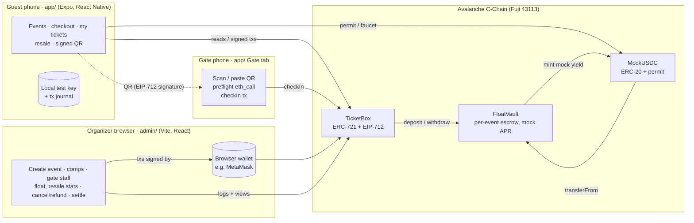
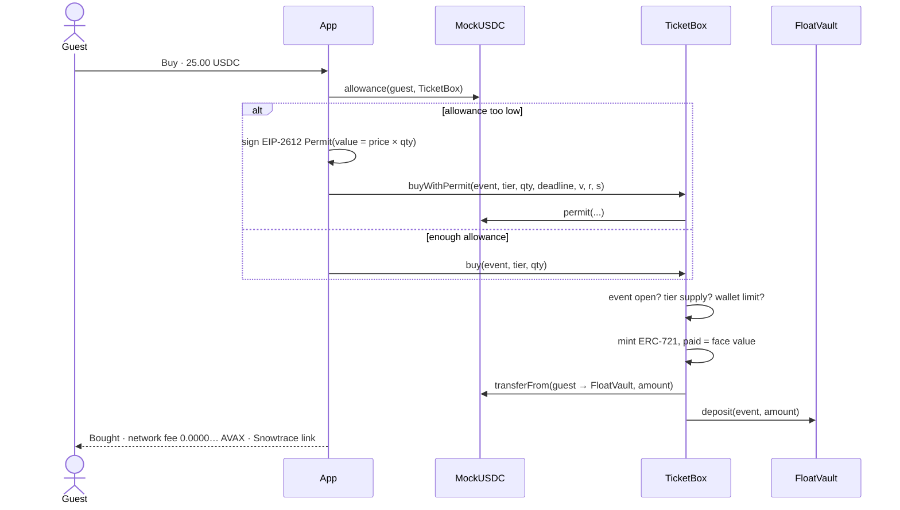
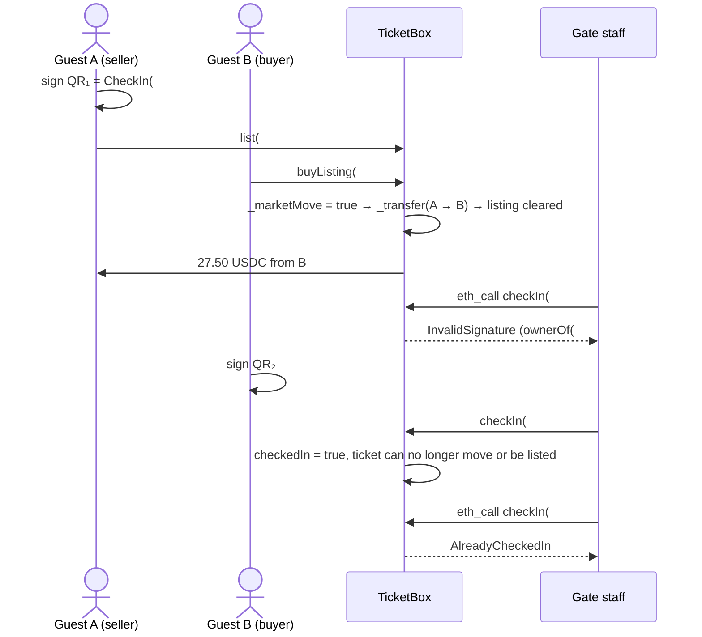
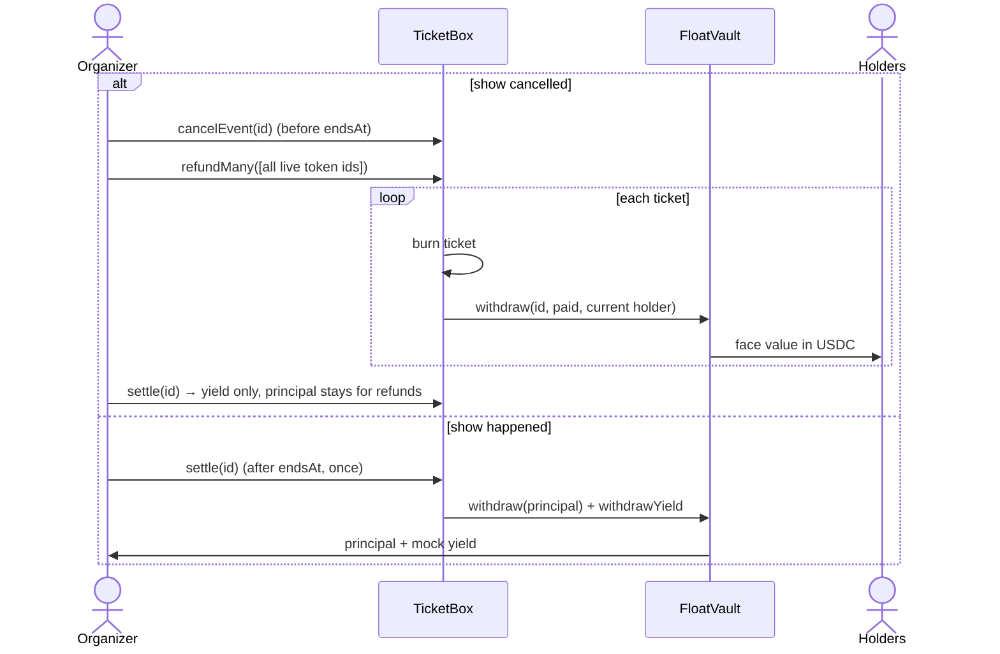
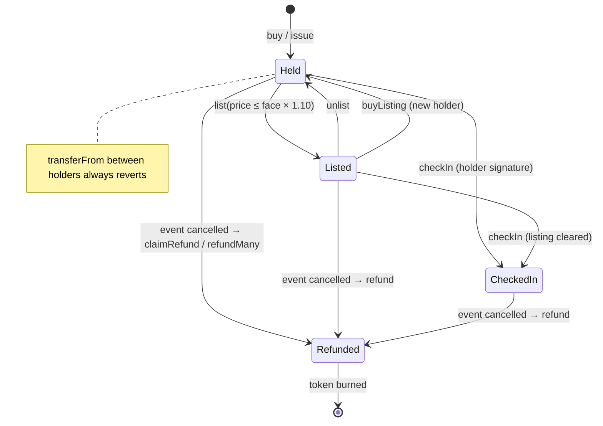

# Architecture

Three contracts on the Avalanche C-Chain (Fuji for the demo), a guest app and an organizer console that talk to the chain directly. There is no backend and no server-side key.

## System

- `TicketBox` owns all ticket state: events, tiers, per-token data, listings, scanners, refunds. It is the only contract that can move money out of `FloatVault`.
- `FloatVault` keeps one account per event (`principal`, `accrued`, `last`). Yield is a fixed 5 % APR, minted in mock USDC when the organizer settles. In production it becomes an ERC-4626 vault over Aave v3 USDC.
- `MockUSDC` is a 6-decimal ERC-20 with EIP-2612 `permit` and a faucet, standing in for Circle USDC on testnet.
- The app keeps a journal of every signed transaction (raw bytes, hash, nonce) so a lost connection never leads to signing twice; unknown outcomes are looked up and rebroadcast byte for byte.

## Buy with USDC (one transaction)

## Capped resale and the dead QR

`transferFrom` and `safeTransferFrom` between holders revert with `TransferBlocked`: `_update` only allows a holder-to-holder move while `_marketMove` is set inside `buyListing`.

## Cancel, refund, settle

A holder can also call `claimRefund(tokenId)` from the app. The refund goes to whoever holds the ticket when the event is cancelled, at the face value the organizer received; a resale premium stays with the seller who earned it.

## Ticket states

Event states: `on sale` (before `endsAt`) → `ended` (organizer may `settle` once) or `cancelled` (sales, listings and check-in revert; refunds open).

## Data flow

| Data | Where it lives | Who writes | Who reads |
|---|---|---|---|
| Event name, venue, times, tiers, limits | TicketBox storage | organizer (`createEvent`) | app, console |
| Ticket owner, tier, paid, listing, checked-in | TicketBox storage | buyer, seller, gate, refunds | app (`ticketsOf`, `getTicket`, `listings`), console |
| Ticket money | FloatVault (USDC balance + per-event principal) | TicketBox only | console (`getEvent` → principal, yield) |
| Activity history | event logs (`Purchased`, `Resold`, `CheckedIn`, `Refunded`, …) | contracts | console (chunked `eth_getLogs` from the deploy block) |
| Signed transactions, outcome tracking | app journal (AsyncStorage) | app | app |
| Check-in QR | guest screen only; EIP-712 signature, valid 180 s | holder's key | gate (eth_call, then tx) |

Nothing personal is written on chain: wallets are pseudonymous and the contract stores no names, emails or phone numbers.

## Security notes and threat model

| Threat | Mitigation | Residual risk |
|---|---|---|
| Scalper resells above face value | `list` reverts above the cap; holder-to-holder transfers revert | selling a whole wallet or private key off-chain |
| Bot buys the whole tier | `maxPerWallet` per event | many wallets (sybil); attestation-gated purchase not built |
| Old holder keeps a QR after selling | `checkIn` verifies against `ownerOf` at check-in time; QR expires in 180 s | a QR is valid for 180 s while the holder still holds it |
| Same QR scanned twice | `AlreadyCheckedIn`; the app also refuses while its own check-in tx is pending | none on chain |
| Seller raises the price under a pending purchase | `buyListing(tokenId, maxPrice)` reverts `PriceChanged` | none |
| Organizer runs away with ticket money | `settle` only after `endsAt`; after cancel only the yield can leave; principal only to holders | an organizer could set a far-future `endsAt`; production would add a maximum hold time and a multisig |
| Reentrancy on refunds / purchases | `nonReentrant` on money paths, state cleared and ticket burned before the USDC transfer | USDC is a plain ERC-20 here |
| Gate staff misuse | scanners are per event and revocable | a staff wallet with a fresh QR could admit without the guest present |
| Lost connection after signing | app journal: never re-sign, look up and rebroadcast the same raw tx | the user waits for the lookup |
| Mock components | MockUSDC faucet and mock APR are clearly marked in code and README | not suitable for real funds; not audited |

Tests: 32 Foundry tests on every money path (one fuzz test on the cap), 11 app chain tests against a real anvil, browser end-to-end flows for the app and the console. See the README for commands.
