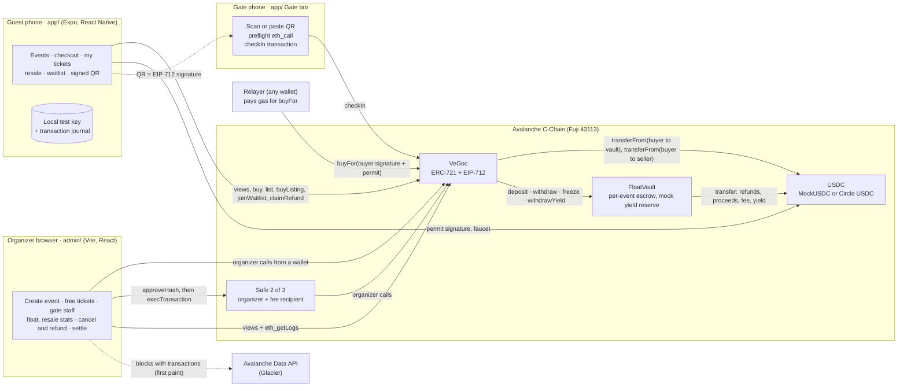
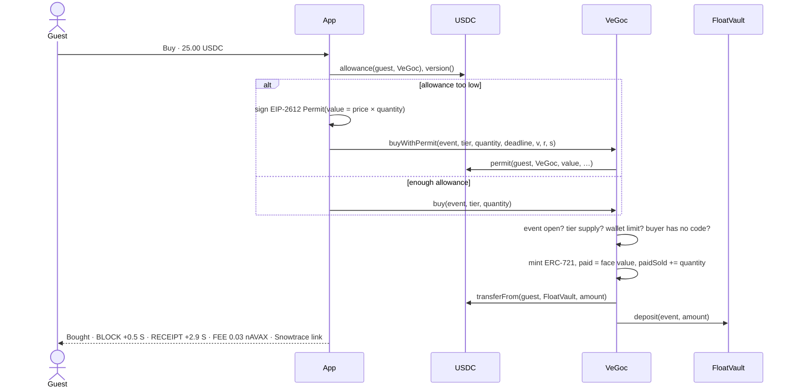
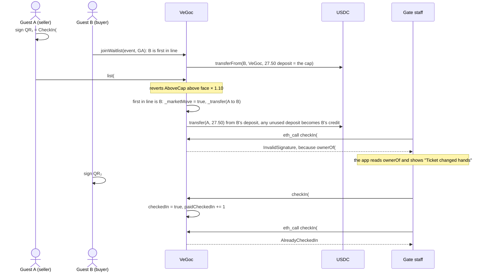
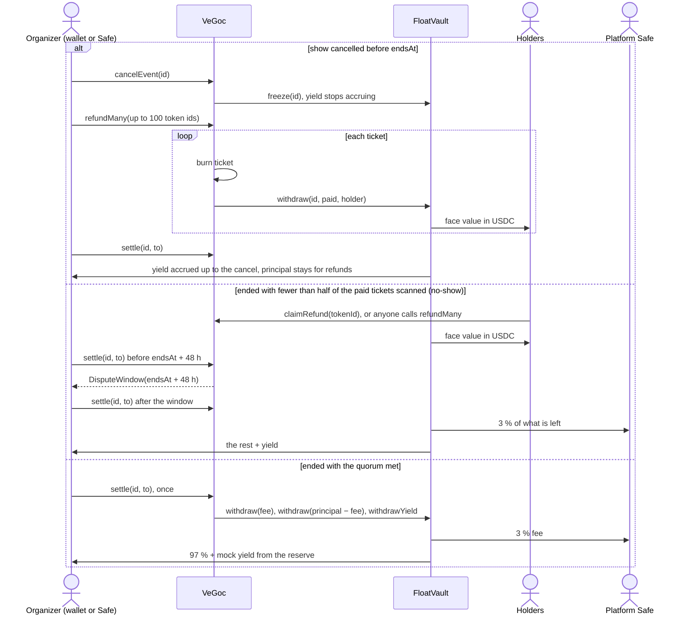
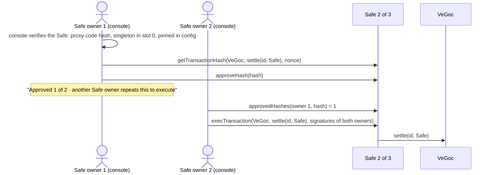
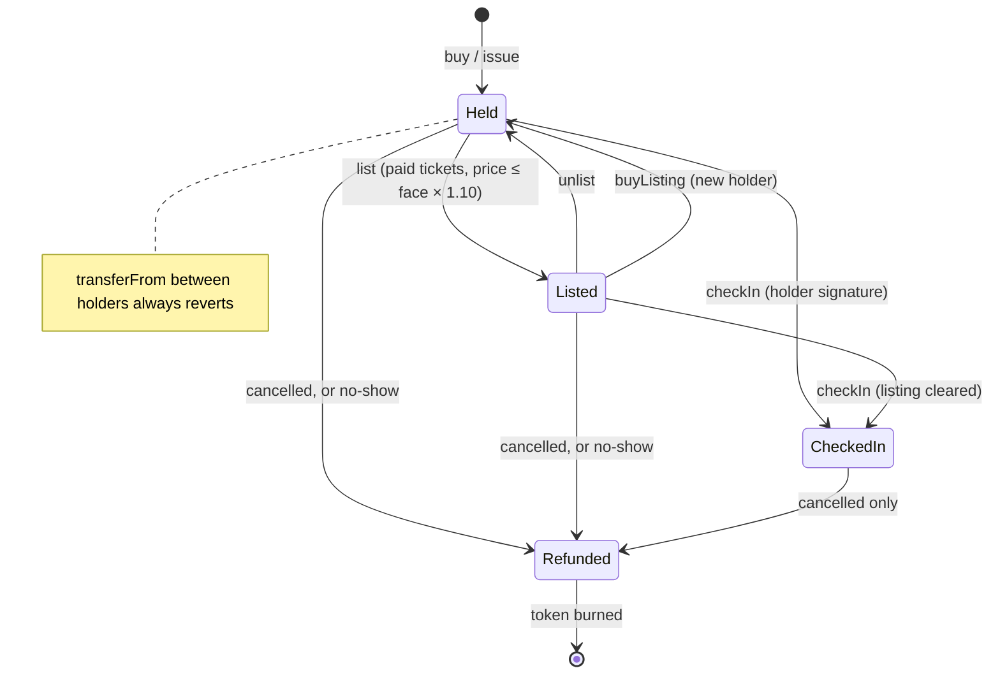
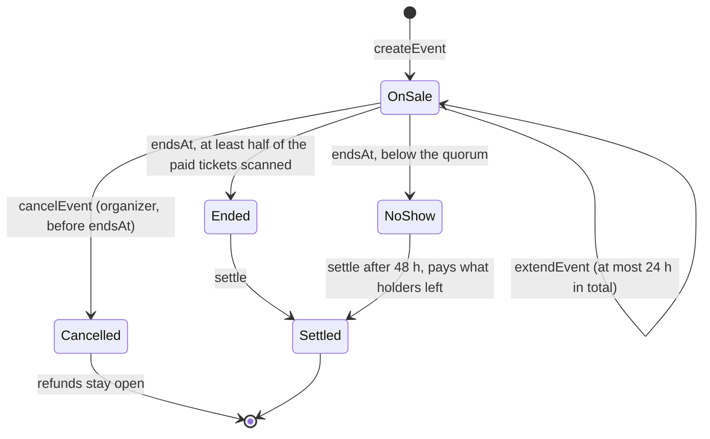
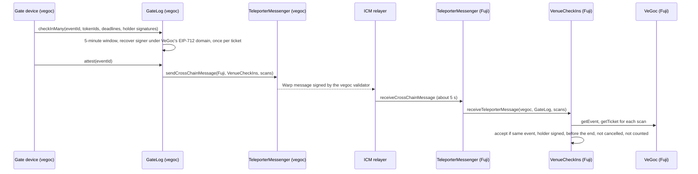

# Architecture

Two contracts on the Avalanche C-Chain (Fuji for the demo), a payment token, a guest app and an organizer console. Both front ends talk to the chain directly. There is no backend and no server-side key.

## System

- `VeGoc` owns all ticket state: events, tiers, per-token data, listings, scanners, attendance, refunds. It is the only caller `FloatVault` obeys.
- `FloatVault` keeps one account per event (`principal`, `accrued`, `last`, `frozen`) and a per-event reserve (`reserveOf`) that the event's mock yield is paid from; `reserve` is their sum. One event cannot collect yield that was funded for another. `balance >= totalPrincipal + reserve` holds at all times and is asserted in the tests, including a fuzz test.
- The payment token is a constructor argument. The main deployment uses `MockUSDC` (6 decimals, EIP-2612 `permit`, faucet); the second deployment uses Circle's USDC on Fuji.
- The app keeps a journal of every signed transaction (raw bytes, hash, nonce), so a lost connection never leads to signing twice; unknown outcomes are looked up and rebroadcast byte for byte.
- Neither contract has an owner, a pause or an upgrade path. `FloatVault.setBox` is a one-time wiring call by the deployer.

## Who can do what

| Action | Who | Condition |
|---|---|---|
| `createEvent` | anyone; the caller becomes the organizer | ends in the future, at most 365 days ahead, lasts at most 30 days; name and venue at most 120 bytes; 1 to 4 tiers, each with a name of 1 to 32 bytes and a supply above 0 |
| `setScanner`, `issue`, `cancelEvent` | the event's organizer | `issue` and `cancelEvent` only before `endsAt` |
| `extendEvent` | the event's organizer | before `endsAt`; moves the end back by at most 24 hours in total (a gate that was down keeps scanning) |
| `settle` | the event's organizer | after `endsAt` if the gate quorum is met, else after `endsAt + 48 h`; once. After a cancel: yield only |
| `buy`, `buyWithPermit` | any address without code | event open, tier supply, per-wallet limit |
| `buyFor` | anyone (a relayer that pays the gas) | the buyer's EIP-712 `Buy(buyer, eventId, tier, quantity, nonce, deadline)` signature and the buyer's token permit; ticket and payment are the buyer's, the relayer can change nothing |
| `list`, `unlist` | the holder | paid ticket, not checked in, event open, price at most face × 1.10. If anyone is on the tier's waitlist, `list` sells to the first in line in the same transaction |
| `buyListing`, `buyListingWithPermit` | any address without code, except the seller | listed, price at most `maxPrice`, event open, nobody waiting for that tier (`WaitlistFirst`) |
| `joinWaitlist`, `joinWaitlistWithPermit` | any address without code | event open, no listing open in the tier (`ListingsOpen`), not already waiting; pays in the resale cap as a deposit |
| `leaveWaitlist`, `withdrawCredit` | the waiting wallet | any time; returns the deposit, or the part of it the seller's price did not use |
| `matchListing` | anyone | continues a match that `list` stopped after 32 left places |
| `checkIn` | a scanner of that event | before `endsAt`, not cancelled, signature by the current holder, deadline at most 5 minutes ahead, not used before |
| `claimRefund` | the holder | event cancelled, or ended below the quorum and not settled (then only unscanned tickets) |
| `refundMany` | anyone | same refund rules; at most 100 ids per call; pays the holders |
| `FloatVault.deposit / withdraw / freeze / withdrawYield` | VeGoc only | |
| `FloatVault.fundReserve(eventId, amount)` | anyone | for one event; tokens cannot be taken back |
| ERC-721 `approve`, `setApprovalForAll` | the holder | callable, but an approval never moves a ticket: `transferFrom` reverts for everyone |

## Buy with USDC (one transaction)

`deposit` is bookkeeping: VeGoc moves the tokens to the vault itself with `safeTransferFrom` and then tells the vault how much arrived for which event. The vault accepts that call from VeGoc only. The permit's EIP-712 version comes from the token (`version()`, "2" for Circle's USDC; "1" when the token has no such function).

## Capped resale and the dead QR

The QR carries `{chainId, contract, tokenId, deadline, holder, signature}`. The signature is over the EIP-712 struct `CheckIn(uint256 tokenId,uint256 deadline)` with the domain `EIP712Domain(string name,string version,uint256 chainId,address verifyingContract)` = `("VeGoc", "1", 43113, <VeGoc address>)`, so a QR made for one deployment or chain is worthless on another. The contract recovers the signer with ECDSA and compares it with `ownerOf(tokenId)`; ERC-1271 is not consulted. The contract's error is `InvalidSignature`; "Ticket changed hands" (`OwnerChanged` in the app's code) is the app's wording when the QR names a holder who is no longer the owner.

## Cancel, no-show, settle

Refunds go to whoever holds the ticket at the time, at the face value the organizer received. A resale premium already went to the seller and is not refunded. In a no-show a scanned ticket has no claim, because its holder was let in. Check-in closes at `endsAt`, so the quorum cannot change once an event has ended.

Mock yield: `accrued += principal × 500 / 10000 × seconds since the last change / 365 days`, updated on every deposit and withdrawal. `withdrawYield` pays `min(accrued, reserveOf[event])` out of that event's reserve; a shortfall stays owed and principal is never used.

## Organizer actions through a Safe

The console uses the Safe contract itself and no transaction service. Approvals are read from `approvedHashes`, so the second owner only has to open the same action. Before any of this the console checks that the organizer really is a Safe: its runtime code must hash to the canonical Safe proxy, storage slot 0 must hold a canonical v1.4.1 singleton ([safe-deployments](https://github.com/safe-global/safe-deployments/tree/main/src/assets/v1.4.1)), and its address must be listed in `VITE_SAFES`. Any other contract organizer is shown as an unverified contract and nothing is sent to it. Every confirmation that goes through the Safe shows its address, owners and threshold.

## Ticket and event states

## Data flow

| Data | Where it lives | Who writes | Who reads |
|---|---|---|---|
| Event name, venue, times, tiers, limits | VeGoc storage | organizer (`createEvent`) | app, console |
| Ticket owner, tier, paid, listing, checked-in | VeGoc storage | buyer, seller, gate, refunds | app (`ticketsOf`, `getTicket`, `listings`), console |
| Ticket money | FloatVault (USDC balance, per-event principal, reserve) | VeGoc only | console (`getEvent`: principal, yield, settle time, refund state, quorum) |
| Activity history | event logs (`Purchased`, `Resold`, `CheckedIn`, `Refunded`, `Settled`, …) | contracts | console: first paint from the Avalanche Data API's transaction list (which blocks to read), then chunked `eth_getLogs` from the deploy block for completeness |
| Signed transactions, outcome tracking | app journal (AsyncStorage) | app | app |
| Check-in QR | guest screen only; EIP-712 signature, valid 180 s | holder's key | gate (eth_call, then transaction) |

Nothing personal is written on chain: wallets are pseudonymous and the contract stores no names, emails or phone numbers.

`ticketsOf`, `listings` and `getEvents` loop over all tickets or events. That is acceptable for `eth_call` at this scale (about 150 tickets on the Fuji deployment) and needs an indexer for large events. `refundMany` is capped at 100 tickets per call, about 5 million gas.

## The venue L1 `vegoc` (live on Fuji)

Avalanche's own ticketing references run on dedicated chains: SK Planet and Dreamus put OK Cashbag tickets on the UPTN subnet ([Avalanche, 21 Sep 2023](https://www.avalanche.com/blog/korean-entertainment-giant-powers-ticketing-platform-with-avalanche)), and FIFA's ticket-right tokens moved to a FIFA L1 ([Cointelegraph, 22 May 2025](https://cointelegraph.com/news/fifa-avalanche-l1-nft-marketplace)). Since 21 Nov 2026 we run one: `vegoc`, chainId 510101, blockchainID `6M7vAPShYSv6WnXxWwA7ZAsMmRFuRRkTLqe2Pj8TCxX6TuHqG`, subnetID `EW5oFkzj5Xk2TXitcaKALxWkBDQQ4yMD5jT6Uyh9cZP5HhUkn`, a sovereign L1 (Subnet-EVM 1.15.3, ACP-77 conversion, PoA validator manager on the L1) with gas token VGC and one validator on a team laptop.

Why a separate chain: it is operated by the venue, so the gate's writes cost the venue's own token rather than AVAX, and the door keeps working at its own pace when the C-Chain is congested on show night. The money stays on the C-Chain. ICM carries what the two must agree on: event outcomes from VeGoc to the venue, and the gate's check-in attestations back to a contract on Fuji next to the money.

| | Fuji C-Chain | vegoc |
|---|---|---|
| Outcome of an event | `AttendanceRelay` [`0xe18c8961b7706fe149faa474a3f835e1530c34f7`](https://testnet.snowtrace.io/address/0xe18c8961b7706fe149faa474a3f835e1530c34f7) reads VeGoc and sends | `AttendanceMirror` `0x744e2be19b816f280e35ae441e6ba51f7b5d4c78` stores it |
| Gate check-ins | `VenueCheckIns` [`0xeb34aca78c23374e36e3a03cf9bcc311186e14f0`](https://testnet.snowtrace.io/address/0xeb34aca78c23374e36e3a03cf9bcc311186e14f0) checks each scan against VeGoc and counts it | `GateLog` `0xa469888cdfa2ffad68a9babbd92d29d95c577c36`: the gate device records the holder-signed QR and sends batches |

The other direction is the same shape: anyone calls `AttendanceRelay.relay(eventId)` on Fuji after the event is final, and Teleporter on vegoc calls `AttendanceMirror`. Both receivers revert unless the caller is Teleporter, the source chain is the expected one and the sender is the expected contract; the two pairs name each other through addresses computed before deployment. Runs, with hashes: README, [ICM and the venue L1](../README.md#icm-and-the-venue-l1-vegoc), and [`vegoc-icm.json`](vegoc-icm.json).

What the live L1 does not have yet, against the full design below: ticket state still lives on the C-Chain (VeGoc is unchanged), VeGoc's settlement does not read the venue's count, there is no fee manager, and there is one validator. The transaction allow list is live since the network upgrade of 21 Nov ([`l1/`](../l1/README.md)): the organizer is its admin and enables gate devices; an outsider's transaction is refused by the node ([`vegoc-allowlist.json`](vegoc-allowlist.json)). The organizer console reads VenueCheckIns per event (Gate staff tab).

| Question | Full design |
|---|---|
| What moves to the L1 | ticket state: events, ERC-721 tickets, listings, check-ins |
| What stays on the C-Chain | the money: USDC, FloatVault, settlement, the Safe |
| Fee token and gas | a gas token held by the platform and the venues (VGC today); guests and gate phones are funded through a sponsored relayer, so a scan or a purchase costs the guest nothing |
| Who may send transactions | the transaction allow-list precompile admits the relayer, organizers and scanner wallets, which makes "only our gate phones can check in" a chain rule (live on vegoc since 21 Nov, together with GateLog's own gate list) |
| Validators | the platform plus two or three large venues or organizers; they are the parties that already have to trust each other |
| What crosses ICM (Teleporter) | C-Chain to L1: `Paid(eventId, buyer, tier, quantity)` after USDC reached the vault, so the L1 mints, and the event outcome (live). L1 to C-Chain: check-in attestations (live) and, in the full design, `Attendance(eventId, paidSold, paidCheckedIn)` read by the vault's quorum, and `Refund(tokenId, holder, amount)` after a cancel |
| What gets worse | a purchase becomes two steps (pay on the C-Chain, mint after the message arrives), and the venue validators can censor |

## Security notes and threat model

| Threat | Mitigation | Residual risk |
|---|---|---|
| Scalper resells above face value | `list` reverts above the cap; holder-to-holder transfers revert | see the next row |
| Scalper lists at the cap for a named customer and takes the premium through an escrow that pays once `ownerOf(ticket) == customer` (round-2 review) | a seller does not pick the buyer: while anyone waits for the tier, `list` hands the ticket to the first in line and `buyListing` reverts `WaitlistFirst`; joining needs a deposit of the full cap, and contracts cannot queue (regression `test_F_namedBuyerBehindInLine_getsNothing_escrowNeverPays`) | when nobody is waiting, a listing is open to the first taker and the named customer can still win the race (`test_F_residual_withNoOneElseInLine_theSideDealStillWorks`). The cap binds the on-chain price only; selling a wallet's key also stays possible |
| Wrapper contract holds a ticket and its control is sold (round-1 review, fixed) | tickets go only to addresses without code; check-in takes ECDSA from the holder only | selling a wallet's private key: the seller keeps a copy. A wallet with an EIP-7702 delegation has code and cannot buy. A contract that buys from its constructor holds a ticket nobody can check in |
| Free tickets sold on the market with no escrow behind them (round-1 review, fixed) | `list` reverts for a ticket with `paid == 0` | none on chain |
| A QR that never expires is sold as a print-at-home ticket (round-1 review, fixed) | `checkIn` refuses a deadline more than 5 minutes ahead; the app signs 3 minutes | a QR is usable for up to 5 minutes while the signer still holds the ticket |
| Organizer does not hold the show and takes the float (round-1 review, fixed; quorum raised in round 2) | below a scan quorum of half the paid tickets refunds open and `settle` waits 48 hours; scans need the holders' signatures (`test_E_twoSockWalletsOutOfTen_doNotMakeAQuorum`) | an organizer who buys half of the paid tickets through their own wallets and scans them still fakes the quorum. They get their own money back at settlement, so the attack costs only the 3 % fee on those tickets and the capital locked until the end (`test_E_residual_halfTheHouseInOwnWallets_stillMeetsTheQuorum`). Holders who do not claim within 48 hours lose the claim once the organizer settles (anyone can push `refundMany` for them) |
| The gate fails at a real show (venue network down) and too few are scanned | the organizer can `extendEvent` by up to 24 hours in total before the end, so scanning and the quorum count continue | if the organizer does not extend in time, every unscanned holder of a show that did happen can take a refund |
| Check-in before the show starts | none: `checkIn` closes at `endsAt` but does not wait for `startsAt` | the seeded Fuji showcase (12 to 13 Dec) was scanned in advance so the console has a gate history; a production contract should open the gate a few hours before `startsAt` |
| Organizer delays refunds after a cancel to earn yield | yield freezes at `cancelEvent` | none |
| Organizer sets a far-off end date to sit on the money | `endsAt` at most 365 days after creation, duration at most 30 days | a year is still long |
| Bot buys the whole tier | `maxPerWallet` per event | many wallets (sybil); purchase-time attestations are not built |
| Old holder keeps a QR after selling | `checkIn` verifies against `ownerOf` at check-in time | none |
| Same QR scanned twice | `AlreadyCheckedIn`; the app also refuses while its own check-in is pending | none on chain |
| Seller raises the price under a pending purchase | `buyListing(tokenId, maxPrice)` reverts `PriceChanged` | none |
| A QR for another deployment or chain | EIP-712 domain binds chain id and contract address | none |
| Reentrancy on refunds and purchases | `nonReentrant` on money paths; state cleared and ticket burned before the USDC transfer | the token is trusted (USDC) |
| Mock yield drains ticket money, or one event drains another's reserve (round-2 review, fixed) | yield is paid from the event's own `reserveOf` only; `balance >= totalPrincipal + reserve` (`test_G_anEventOnlyEarnsFromItsOwnReserve`) | none; with an empty reserve the yield stays owed |
| Relayer tampers with a relayed purchase | `buyFor` checks the buyer's EIP-712 signature over event, tier, quantity, a per-buyer nonce and a deadline; the permit is the buyer's | a relayer can refuse to send; the buyer can then buy directly |
| Spam events on the public contract | bounded text lengths; the app lists only configured organizers | view functions are linear in events and tickets |
| A contract poses as a Safe in the console (found in review of the console's Safe support, fixed) | an organizer is a Safe only with the canonical proxy code hash, a canonical singleton in slot 0 and a pin in the config; checked again before each transaction; the confirmation shows the Safe's address, owners and threshold | the console trusts its own config file |
| Gate staff misuse | scanners are per event and revocable | a staff wallet with a fresh QR could admit without the guest present |
| Lost connection after signing | app journal: never re-sign, look up and rebroadcast the same raw transaction | the user waits for the lookup |
| Keys in the demo build | only throwaway testnet keys for Guest A, Guest B and Gate staff, on chains 31337 and 43113 | anyone with the bundle can move those test tickets |
| Safe owner keys | the showcase Safe is 2 of 3 | all three owner keys are team keys on one laptop (owner 1 and owner 2 in the same gitignored `.env.fuji`), so on testnet the Safe shows the flow, not independent custody |
| Mock components | MockUSDC and the mock yield are labelled in the NatSpec and listed in the README | not for real funds; not audited |

Tests: 84 Foundry unit tests on every money path, the ICM relay and the venue L1 gate (three fuzz tests), 4 fork tests against Circle's USDC and a real Safe on Fuji, 57 app chain tests and 33 console tests, and 17 browser end-to-end flows for the app and the console. Commands are in the README.
